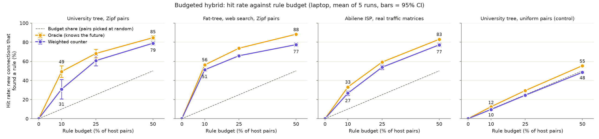
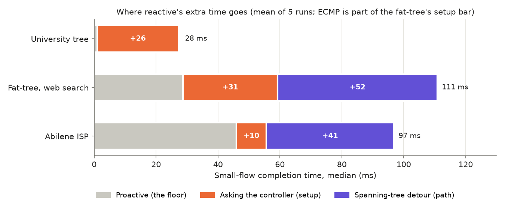

# Step 4: Long Timeouts, Budgeted Hybrid, Oracle, Repeats and Two PCs

CS G525 Advanced Computer Networks, Project SA7, Group 2. This step covers the
comparisons that were still missing from `docs/Evaluation_Plan.md`:

| Plan item | What it asks | Where it is now |
| --- | --- | --- |
| #6 | Is "keep reactive rules longer" (SmartTime-style) enough? | mode `reactive-long` |
| #7 | What does a fixed budget of K pre-installed rules buy, chosen by a simple weighted counter? | modes `reactive-sp`, `hybrid-NN`, budget sweep |
| upper bound | How far is the counter from a perfect predictor? | mode `oracle-NN` |
| statistics | Are the differences larger than the run-to-run noise? | `--repeats N`: mean and 95% confidence interval |
| #9 / Review I point 3 | Does the controller sharing the PC with Mininet change the result? | `--controller-host`, see [Controller_On_Second_PC.md](Controller_On_Second_PC.md) |

The parameters, and the paper behind each, are in
[Realism_Sources.md](Realism_Sources.md).

## 1. The controllers compared

| Mode | Controller | Rules | What it tests |
| --- | --- | --- | --- |
| `reactive` | `reactive_eval` over a spanning tree; exact match; idle 10 s, hard 30 s | one per TCP connection per switch | the Review I baseline |
| `reactive-long` | same, but idle 60 s, hard 300 s | same | "just keep rules longer" (#6) |
| `reactive-sp` | `hybrid_eval --budget=0`: reactive, but on the shortest path (it knows the topology) | one per TCP connection per switch | the 0% point of the sweep; separates "reactive" from "spanning tree" |
| `hybrid-NN` | `hybrid_eval --budget=NN%`: reactive for everything, plus pair rules for the top NN% of host pairs chosen by a weighted counter | at most NN% of all host pairs × path length, plus the reactive rules | #7 |
| `oracle-NN` | `hybrid_eval --pairs_file`: pre-installs the NN% of pairs that **really** carry the most flows in this run, before the first flow | as `hybrid-NN` | the best any predictor (counter, ML, anything) could do with the same budget |
| `proactive` / `proactive-ecmp` | `proactive_eval`: every pair pre-installed | all pairs | the other end |

### The weighted counter (`controllers/hybrid_eval.py`)

Every second, for every (source, destination) host pair:

```
score = 0.97 * score + active        active = 1 if the pair was used in the last second, else 0
```

The controller learns that a pair was used in one of two ways:

- **Pair not pre-installed:** its new flow reached the controller as a
  PACKET_IN at the sender's switch.
- **Pair pre-installed:** its packets no longer reach the controller, so
  every second the controller asks the sender's switch for the packet
  counter of the pair rule. It counts as used if the counter went up.

Then the controller does three things:

1. **Keep the top K.** The K pairs with the highest score get a pair rule
   (match source MAC + destination MAC) on every switch of their shortest
   path. K = budget × all pairs; 240 pairs on the 16-host tree.
2. **Hysteresis.** A newcomer replaces the weakest kept pair only if its
   score is 1.5 times higher. Without this, pairs near the cut-off were
   swapped in and out every second.
3. **Removal.** A pair that drops out has its rules deleted. If its rule
   never matched a packet, it counts as a *wasted install*.

Everything not pre-installed is handled reactively, on the shortest path,
with exact-match rules. No flow is ever dropped because of the budget; a
miss only costs a trip to the controller.

Small example with a budget of 2 pairs (scores after each one-second tick):

| Second | h1→h2 | h3→h4 | h5→h6 | Installed |
| --- | --- | --- | --- | --- |
| 1 | used: 1.00 | used: 1.00 | - | h1→h2, h3→h4 (free budget) |
| 2 | used: 1.97 | idle: 0.97 | used: 1.00 | unchanged: h5→h6 needs more than 1.5 × 0.97 = 1.46 |
| 3 | used: 2.91 | idle: 0.94 | used: 1.97 | h5→h6 replaces h3→h4 (1.97 > 1.5 × 0.94) |

A pair used every second settles at a score of 1 / (1 − 0.97) ≈ 33. A pair
that stops being used loses half its score in about 23 s.

### The oracle: a controller that knows the future

The oracle cannot exist in a real network; it is a measuring stick. The
harness generates the whole flow schedule before the run, so it knows which
host pairs will be busiest:

1. It counts the flows of every pair in both directions, because the TCP
   reply needs the reverse rule.
2. It writes the K busiest pairs to a file.
3. `hybrid_eval --pairs_file` installs exactly those pairs before the first
   flow and never changes them.

Its hit rate is the best that any method choosing K pairs can reach: a
counter, logistic regression, XGBoost or anything else. So
**oracle − counter** is the most a smarter predictor could ever add at that
budget, measured without building one. This is the same idea as Belady's
optimal algorithm in caching (1966), which knows all future requests and
serves as the bound for real cache algorithms.

Limit: it is the best *fixed* set of pairs. Here pair popularity does not
change during a run, so a fixed set is the right bound. If popularity
shifted over time, an oracle that swaps pairs could do better.

**Hit rate** = the share of new TCP connections whose first packet (SYN)
found a rule at the sender's switch, i.e. did not go to the controller.

## 2. How to run (laptop)

```bash
# Budget sweep on the university tree, skewed pairs (about 25 minutes, 11 runs)
sudo python3 experiments/run_traffic_experiments.py --scenarios tree-d2-f4:university \
    --budget-sweep --pair-zipf 1
# The same with uniform pairs (pFabric's assumption): no pair is popular, so the counter
# should not beat its budget share. This is the control experiment.
sudo python3 experiments/run_traffic_experiments.py --scenarios tree-d2-f4:university \
    --budget-sweep --pair-zipf 0
# Data centre and ISP
sudo python3 experiments/run_traffic_experiments.py --scenarios fattree-k4:websearch --budget-sweep --pair-zipf 1
sudo python3 experiments/run_traffic_experiments.py --scenarios abilene:isp --budget-sweep
```

The ISP workload ignores `--pair-zipf`: its pairs come from the real Abilene
traffic matrices, which are already skewed.

Options:

- `--budgets 5 10 25 50` changes the budget points.
- `--decay` and `--hysteresis` change the counter.
- `--long-idle` and `--long-hard` change `reactive-long`.

**Repeats.** Add `--repeats 5` to any command. Every controller then runs 5
times, with seeds 7 to 11, so each run gets a new flow schedule from the same
workload. The tables then show the mean ± the half-width of the 95%
confidence interval (Student's t), plus an "Every run" table. The plots show
error bars, and the CDFs pool all runs. Use at least 5 repeats: with 2, the
t-multiplier is 12.7 and the intervals are meaninglessly wide. The repeats
are the outer loop (all controllers for seed 7, then all for seed 8, ...), so
a slow drift of the machine hits every controller equally.

Output: `results/measured/traffic-<timestamp>/`:

- `traffic.md`: tables, including "Budgeted hybrid" with hit rate and
  installs;
- `traffic.json`;
- `traffic_budget.png`: hit rate, small-flow median FCT, PACKET_IN/s and
  peak rules against the budget, for the counter and the oracle, with
  reactive, reactive-long and proactive as reference lines;
- the usual Step 2 plots.

## 3. First results: cloud test machine, NOT for the report

This run is only a check that everything works. It used the cloud box: a
4-CPU VM with userspace Open vSwitch (no kernel datapath) and no netem.
Userspace OVS makes every miss and every packet far slower than on the
laptop, so **absolute FCTs are 10–30× the laptop's**. Only the ordering and
the ratios mean anything. The laptop run replaces this table.

University traffic, `tree-d2-f4`, Zipf-1 pairs (the busiest 10% of pairs
carry 60% of the flows), 30 s, 6,088 flows, one run, no failed flows:

| Controller | Hit rate | Small-flow FCT median (ms) | Small p99 (ms) | PACKET_IN/s | CPU % | Peak rules |
| --- | --- | --- | --- | --- | --- | --- |
| Reactive (spanning tree, 10 s / 30 s) | - | 225.5 | 7,602 | 1,214 | 34.6 | 12,327 |
| Reactive, long timeouts (60 s / 300 s) | - | 220.6 | 10,270 | 1,199 | 32.7 | **32,325** |
| Reactive on shortest paths (budget 0%) | 0% | 205.0 | 8,411 | 1,212 | 33.4 | 12,717 |
| Hybrid counter, 10% of pairs | 35.7% | 133.0 | 6,778 | 722 | 24.7 | 6,937 |
| Hybrid counter, 25% | 63.8% | 62.5 | 2,789 | 441 | 18.8 | 4,829 |
| Hybrid counter, 50% | 81.0% | 32.9 | 1,107 | 241 | 14.1 | 2,636 |
| Oracle, 10% | 51.6% | 83.3 | 3,326 | 576 | 21.2 | 5,494 |
| Oracle, 25% | 70.6% | 34.8 | 1,135 | 360 | 16.7 | 3,304 |
| Oracle, 50% | 85.7% | 18.7 | 1,071 | 196 | 10.8 | 1,988 |
| Proactive (all pairs) | 100% | 7.7 | 1,055 | 0 | 0.0 | 624 |

Counter: 75 / 147 / 221 pair installs, 48 / 67 / 67 of them wasted (removed
before ever matching a packet).

What this run says, without sugar-coating:

1. **Long timeouts do nothing for this traffic except fill the tables.**
   Same PACKET_IN rate and the same FCT as normal reactive, with 2.6× the
   rules. The reason: the rules are exact matches, and every new TCP
   connection has a new source port, so a rule kept longer is never matched
   again. "Keep rules longer" only helps if rules are coarser (per pair) or
   if the same 5-tuple repeats. That is a real limit of the SmartTime-style
   approach for short-flow traffic.
2. **A small budget of pair rules beats reactive on every metric at once.**
   At 25% of pairs:
   - small-flow median 3.3× lower (62.5 vs 205 ms);
   - PACKET_IN/s 2.7× lower;
   - **2.6× fewer rules** than reactive.

   One pair rule replaces many per-connection rules.
3. **The counter is close to the oracle at 25–50% but clearly worse at
   10%.**
   - At 10%: 35.7% vs 51.6% hit rate. It wastes 48 of 75 installs while it
     is still learning which pairs are busy.
   - At 25%: 64% vs 71%.
   - At 50%: 81% vs 86%.

   This gap is the most a better predictor (ML or anything else) could add,
   and it is only large at a small budget.
4. **Even the oracle does not reach proactive.** Proactive has the fewest
   rules of all (624: 240 pairs, a few hops each). On a 16-host network,
   "pre-install everything" is cheap. The budget only matters when all
   pairs do not fit in the switches. That is true for large networks, not
   for ours: **be careful when presenting this**.

Not yet known: whether these hold on the laptop (kernel datapath), with
uniform pairs (`--pair-zipf 0`, where we expect the counter to gain only
about its budget share), on the fat-tree and Abilene, and with confidence
intervals (`--repeats 5`).

## 4. Laptop results

### 4.0 Final numbers: 5 repeats with 95% confidence intervals (night of 15–16 Oct)

**These are the numbers to quote.** Sections 4.1–4.7 below are the first single runs, kept as a record.

**How the repeats ran:**
- **Seeds:** every controller ran 5 times, with seeds 7–11, so each run gets a new flow schedule from the same workload.
- **Values:** each value is the mean ± the half-width of the 95% confidence interval (Student's t, 4 degrees of freedom).
- **"Median" column:** each run's small-flow median, averaged over the 5 runs.
- **Power mode:** Windows "Best performance"; the single runs were in "Balanced" (see the note at the end of this section).
- **Raw data:**
  - university, Zipf: `results/measured/traffic-20261015-225412/`
  - fat-tree, web search: `traffic-20261015-233914/`
  - Abilene: `traffic-20261016-004215/`
  - university, uniform: `traffic-20261016-012626/`
  - decay test: `traffic-20261016-021112/`



**University tree, Zipf pairs** (6,073 ± 41 flows per run, 0 failed):

| Controller | Hit rate % | Small-flow median (ms) | PACKET_IN/s | CPU % | Peak rules |
| --- | --- | --- | --- | --- | --- |
| Reactive (spanning tree) | - | 27.9 ± 2.4 | 2,553 ± 114 | 67.2 ± 1.9 | 10,965 ± 637 |
| Reactive, long timeouts | - | 29.6 ± 4.1 | 2,454 ± 106 | 64.8 ± 2.6 | **32,363 ± 2,018** |
| Reactive, shortest paths (0%) | 0 | 27.3 ± 3.9 | 2,549 ± 130 | 68.1 ± 3.1 | 10,983 ± 663 |
| Counter 10% | 30.8 ± 10.2 | 17.7 ± 2.9 | 1,819 ± 196 | 55.9 ± 3.4 | 8,005 ± 872 |
| Counter 25% | 60.7 ± 5.5 | 8.4 ± 1.4 | 936 ± 209 | 35.4 ± 5.8 | 5,278 ± 1,205 |
| Counter 50% | 78.9 ± 1.8 | 2.8 ± 1.0 | 448 ± 66 | 18.7 ± 2.4 | 2,938 ± 347 |
| Oracle 10% | 49.3 ± 6.0 | 11.1 ± 1.3 | 1,145 ± 188 | 41.6 ± 3.8 | 5,621 ± 704 |
| Oracle 25% | 68.2 ± 4.3 | 5.0 ± 0.6 | 658 ± 118 | 25.6 ± 3.1 | 3,586 ± 555 |
| Oracle 50% | 84.7 ± 2.1 | 1.7 ± 0.7 | 324 ± 53 | 12.9 ± 1.5 | 2,012 ± 262 |
| Proactive | 100 | 0.96 ± 0.21 | 0 | 0.1 | 624 |

**Fat-tree, web search, Zipf pairs** (1,121 ± 27 flows per run; reactive and reactive with long timeouts lost 5 ± 15, all in one seed; all others 0):

| Controller | Hit rate % | Small-flow median (ms) | Large flows, mean (s) | PACKET_IN/s | CPU % | Peak rules |
| --- | --- | --- | --- | --- | --- | --- |
| Reactive (spanning tree) | - | 110.8 ± 38.0 | 16.1 ± 7.5 | 455 ± 42 | 25.6 ± 2.0 | 4,406 ± 569 |
| Reactive, long timeouts | - | 111.7 ± 36.1 | 16.1 ± 7.0 | 450 ± 35 | 25.8 ± 1.0 | **10,643 ± 969** |
| Reactive, shortest paths (0%) | 0 | 59.3 ± 6.6 | 9.3 ± 4.8 | 492 ± 55 | 25.8 ± 2.3 | 3,752 ± 428 |
| Counter 10% | 51.1 ± 1.6 | 42.8 ± 6.0 | 9.3 ± 4.4 | 259 ± 26 | 13.8 ± 0.6 | 1,901 ± 104 |
| Counter 25% | 65.8 ± 1.4 | 38.2 ± 5.1 | 9.4 ± 4.7 | 180 ± 14 | 10.1 ± 0.5 | 1,569 ± 89 |
| Counter 50% | 77.4 ± 1.8 | 35.0 ± 5.1 | 9.2 ± 4.8 | 123 ± 15 | 7.4 ± 0.6 | 1,517 ± 84 |
| Oracle 10% | 56.2 ± 1.3 | 38.8 ± 5.2 | 9.5 ± 4.5 | 231 ± 19 | 11.8 ± 0.5 | 1,714 ± 182 |
| Oracle 25% | 73.7 ± 1.2 | 34.0 ± 5.2 | 9.4 ± 4.7 | 139 ± 11 | 7.1 ± 0.3 | 1,221 ± 86 |
| Oracle 50% | 88.3 ± 0.7 | 31.6 ± 5.3 | 9.0 ± 5.0 | 63 ± 5 | 3.3 ± 0.2 | 984 ± 57 |
| Proactive ECMP | 100 | 28.6 ± 5.2 | 9.3 ± 4.9 | 0 | 0.2 | 1,072 |

**Abilene ISP, real traffic matrices** (1,749 ± 43 flows per run, 0 failed):

| Controller | Hit rate % | Small-flow median (ms) | PACKET_IN/s | CPU % | Peak rules |
| --- | --- | --- | --- | --- | --- |
| Reactive (spanning tree) | - | 96.8 ± 6.8 | 604 ± 22 | 27.1 ± 0.7 | 7,339 ± 148 |
| Reactive, long timeouts | - | 97.3 ± 6.2 | 604 ± 16 | 27.3 ± 0.6 | **16,332 ± 427** |
| Reactive, shortest paths (0%) | 0 | 55.6 ± 2.0 | 447 ± 17 | 20.8 ± 0.8 | 5,321 ± 111 |
| Counter 10% | 26.6 ± 2.3 | 53.3 ± 2.2 | 334 ± 26 | 16.6 ± 1.2 | 4,103 ± 357 |
| Counter 25% | 53.8 ± 2.3 | 50.0 ± 2.5 | 198 ± 19 | 10.7 ± 1.0 | 2,615 ± 245 |
| Counter 50% | 77.2 ± 1.8 | 47.4 ± 1.9 | 92 ± 11 | 5.5 ± 0.5 | 1,328 ± 143 |
| Oracle 10% | 33.1 ± 1.0 | 52.7 ± 2.4 | 287 ± 9 | 14.6 ± 0.3 | 3,778 ± 73 |
| Oracle 25% | 59.2 ± 0.8 | 49.4 ± 2.5 | 169 ± 9 | 9.0 ± 0.5 | 2,418 ± 168 |
| Oracle 50% | 83.0 ± 1.0 | 47.2 ± 1.4 | 67 ± 5 | 3.8 ± 0.3 | 1,141 ± 129 |
| Proactive | 100 | 46.0 ± 1.5 | 0 | 0.1 | 386 |

**University tree, uniform pairs (control)** (6,093 ± 101 flows per run, 0 failed):
- **Counter:** 9.6 ± 0.2 / 24.5 ± 1.2 / 48.4 ± 0.2% hit rate at 10 / 25 / 50%.
- **Oracle:** 12.5 ± 0.2 / 29.4 ± 0.5 / 55.4 ± 0.6%.
- **Long timeouts:** small-flow median 25.7 ± 0.8 ms against reactive's 23.6 ± 0.7 ms, and 31,644 rules against 10,836.



### What the repeats say

1. **Long timeouts never help, and once they hurt.**
   - In all 4 scenarios the delay is the same or worse, with 2.2–3.0× the rules.
   - With uniform pairs the long-timeout median is **significantly slower** (25.7 ± 0.8 vs 23.6 ± 0.7 ms; the intervals do not overlap). The likely cause is Open vSwitch working through 3× bigger tables.
2. **Path vs setup: a faster controller shrinks only the setup part.** Reactive's extra small-flow median over proactive:

   | Scenario | Path (spanning tree) | Setup (controller) |
   | --- | --- | --- |
   | University tree | 0.6 ms (within noise) | 26.3 ms |
   | Fat-tree | 51.5 ms (wide interval: reactive's median is 110.8 ± 38.0) | 30.7 ms (includes ECMP's balance) |
   | Abilene | **41.2 ms** | **9.7 ms** |

   Compare the single runs in Balanced power mode (Section 4.7): setup was 52 / 78 / 26 ms, path 0 / 39 / 44 ms. The CPU change cut the setup part by half or more and left the path part the same. **A faster controller hides setup cost, never path cost.** On Abilene, 81% of reactive's extra delay is the path.
3. **A 25% budget, compared with reactive on shortest paths:**
   - **hit rate:** 54–66%;
   - **controller trips:** 2.3–2.7× fewer PACKET_INs;
   - **rules:** 2.0–2.4× fewer;
   - **small-flow median:** 3.3× lower on the university tree (27.3 → 8.4 ms), 1.6× on the fat-tree (59.3 → 38.2), and 1.1× on Abilene (55.6 → 50.0), where the setup part is small.
4. **Counter ÷ oracle hit rate:**

   | Scenario | 10% | 25% | 50% |
   | --- | --- | --- | --- |
   | University, Zipf | 0.62 | 0.89 | 0.93 |
   | Fat-tree, web search | 0.91 | 0.89 | 0.88 |
   | Abilene | 0.80 | 0.91 | 0.93 |

   - **At 25–50%:** 0.88–0.93 everywhere; a perfect predictor would add 5–11 points of hit rate.
   - **At 10% on university traffic:** the counter is both weaker (0.62) and the noisiest result (30.8 ± 10.2%).
5. **With uniform pairs a budget buys only its own share.** This confirms the single run: the gain comes from skew.
6. **Proactive is still best on these networks**, with the fewest rules on the tree and on Abilene. On the fat-tree, the oracle at 50% (984) uses slightly fewer rules than proactive ECMP (1,072), but the counter never does.

**Decay 0.9 instead of 0.97** (one run, seed 7, `traffic-20261016-021112`):
- the counter's hit rate was 36.7% at 10% and 63.8% at 25%, against the oracle's 51.6 / 70.6%;
- with decay 0.97, the 5-run means are 30.8 ± 10.2 / 60.7 ± 5.5%;
- one run sits inside that spread, so **this is not evidence either way**. Deciding it needs `--decay 0.9 --repeats 5`, about 40 minutes.

**Note on the power mode.** The single runs (Sections 4.1–4.7) were in Balanced mode, the repeats in Best performance:
- **what changed:** absolute times; reactive's median on the university tree went from 53 to 28 ms;
- **what held:** every ranking and every ratio within roughly the confidence intervals.

Never compare a single-run number with a repeat number directly.

### 4.1–4.7: the first single runs (15 Oct, Balanced power mode)

Setup of these runs:

- **Machine:** Mrudul's laptop: WSL2, Open vSwitch 3.7.1 with the kernel
  datapath, Python 3.14.
- **Controller:** POX on the same PC as Mininet.
- **Traffic:** university, `tree-d2-f4`, 16 hosts, 240 host pairs, every link
  100 Mbit/s.
- **Run:** 30 s of arrivals; host-pair popularity Zipf 1, so the busiest 10%
  of pairs carry 60% of the flows; one run (seed 7).
- **Result:** 6,088 flows, **0 failed in every run**.
- **Raw data:** `results/measured/traffic-20261015-204208/`.

### 4.1 University traffic, popular pairs (Zipf 1)

| Controller | Hit rate | Small-flow FCT median / p99 (ms) | PACKET_IN/s | Controller CPU % | Peak rules (all switches) |
| --- | --- | --- | --- | --- | --- |
| Reactive (spanning tree, 10 s / 30 s) | - | 53.4 / 137.2 | 2,371 | 83.6 | 11,170 |
| Reactive, long timeouts (60 s / 300 s) | - | 59.1 / 154.2 | 2,327 | 83.6 | **32,644** |
| Reactive on shortest paths (budget 0%) | 0% | 53.7 / 169.0 | 2,329 | 82.7 | 11,159 |
| Hybrid counter, 10% of pairs (24) | 24.5% | 32.5 / 99.4 | 1,685 | 74.4 | 7,588 |
| Hybrid counter, 25% (60) | 62.3% | 12.8 / 76.6 | 861 | 48.2 | 5,010 |
| Hybrid counter, 50% (120) | 80.5% | 4.1 / 61.9 | 365 | 28.3 | 2,340 |
| Oracle, 10% | 51.6% | 16.7 / 67.7 | 1,022 | 55.1 | 5,312 |
| Oracle, 25% | 70.6% | 7.4 / 67.6 | 572 | 39.7 | 3,287 |
| Oracle, 50% | 85.7% | 3.0 / 52.8 | 274 | 22.0 | 1,987 |
| Proactive (all 240 pairs) | 100% | 1.7 / 43.9 | 0 | 0.1 | 624 |

Counter installs and waste per budget:

| Budget | Pair installs | Wasted (removed without matching a packet) | Counter hit rate ÷ oracle hit rate |
| --- | --- | --- | --- |
| 10% | 80 | 53 (66%) | 0.47 |
| 25% | 153 | 71 (46%) | 0.88 |
| 50% | 206 | 55 (27%) | 0.94 |

The plot is `traffic_budget.png` in the same folder.

### 4.2 What the numbers say

1. **Long timeouts make reactive worse, not better.**
   - The small-flow median is 11% slower (59.1 vs 53.4 ms) and the tables
     hold 2.9× the rules.
   - The PACKET_IN rate is the same.
   - Why: reactive rules are exact matches, and every new TCP connection
     has a new source port. A rule that is kept longer is never matched
     again; it only takes space.
   - So "keep rules longer" (SmartTime-style timeout tuning) does not help
     short-flow traffic unless the rules are coarser.
2. **The 0% point equals normal reactive** (53.7 vs 53.4 ms, 2,329 vs
   2,371 PACKET_IN/s). On a tree, the spanning tree is the shortest path.
   So every gain in the hybrid rows comes from the pre-installed pair rules,
   not from better routing.
3. **A budget of 25% of pairs improves every metric at once** compared with
   reactive:
   - 4.2× faster small-flow median (12.8 vs 53.7 ms);
   - 2.7× fewer controller requests;
   - controller CPU down from 84% to 48%;
   - **2.2× fewer rules** (5,010 vs 11,159). One pair rule replaces the many
     exact rules its connections would otherwise create.

   At 50%: 13× faster median and 4.8× fewer rules.
4. **The counter is close to the oracle at 25–50%, far from it at 10%.**
   - It reaches 88% and 94% of the oracle's hit rate at 25% and 50%, but
     only 47% at 10%, wasting 66% of its installs.
   - So a better predictor (ML or anything else) could add at most 5–8
     points of hit rate at 25–50% of pairs, but up to 27 points at 10%.
   - Two candidate causes for the 10% gap:
     - **warm-up:** the counter's memory (about 33 s) is as long as the run;
     - **churn at the cut-off:** with 24 slots, many pairs have similar
       scores.

     Section 4.4 measures both: each explains about half of the gap.
5. **Proactive is still best on this network.** It is the fastest (1.7 ms)
   and has the fewest rules of all (624 = 240 pairs × about 2.6 switches).
   With 16 hosts, every pair fits easily. A rule budget only pays off when
   all pairs do not fit in the switches' tables, which is the case in large
   networks, not in ours. **We must say this when we present the hybrid.**
6. **Reactive's controller load grows faster than its traffic.** It needs
   11.7 PACKET_INs per new flow (2,371/s for 203 flows/s). A connection
   misses at up to 3 switches in each direction, which already gives up to
   6. Under load, more packets of the same connection arrive before its
   rules are in, and each of them goes to the controller too. This is the
   same amplification as in Step 2.

**Laptop vs cloud test (Section 3).** The ordering of all ten controllers is
the same.

- **Oracle hit rates are identical** (51.6 / 70.6 / 85.7%), as they should
  be: the same schedule and the same pairs.
- **The counter's hit rate at 10% differs a lot:** 24.5% on the laptop,
  35.7% in the cloud. The counter depends on timing (which pairs happen to
  be active in each second), so single runs of it are noisy. This is why the
  final numbers need `--repeats 5`.

### 4.3 Control: uniform pairs (`--pair-zipf 0`)

Same network, workload and duration; every destination equally likely, as in
pFabric. 6,102 flows, 0 failed. Raw data:
`results/measured/traffic-20261015-210056/`.

| Controller | Hit rate | Small-flow FCT median / p99 (ms) | PACKET_IN/s | CPU % | Peak rules | Pair installs (wasted) |
| --- | --- | --- | --- | --- | --- | --- |
| Reactive (spanning tree) | - | 63.6 / 217.4 | 2,329 | 88.2 | 10,898 | - |
| Reactive, long timeouts | - | 68.2 / 180.1 | 2,294 | 86.5 | 31,852 | - |
| Reactive on shortest paths (0%) | 0% | 62.2 / 185.0 | 2,327 | 86.9 | 10,984 | - |
| Counter 10% | 9.7% | 52.4 / 133.8 | 2,176 | 84.0 | 9,898 | 78 (50) |
| Counter 25% | 24.5% | 43.1 / 158.3 | 1,902 | 82.1 | 8,494 | 167 (100) |
| Counter 50% | 47.7% | 21.8 / 86.5 | 1,275 | 65.9 | 5,949 | 244 (86) |
| Oracle 10% | 12.7% | 50.1 / 143.9 | 2,051 | 82.2 | 9,631 | 24 (0) |
| Oracle 25% | 29.9% | 33.1 / 93.6 | 1,625 | 72.8 | 7,812 | 60 (0) |
| Oracle 50% | 56.0% | 11.4 / 62.5 | 928 | 52.1 | 4,993 | 120 (0) |
| Proactive | 100% | 1.3 / 38.8 | 0 | 0.1 | 624 | - |

What the control shows:

- **Without popular pairs, a budget of B% buys about B% hit rate** (9.7 /
  24.5 / 47.7% for 10 / 25 / 50%). That is what pre-installing a random B%
  of the pairs would give. There is nothing for the counter to learn.
- **With Zipf pairs, the same budgets bought 24.5 / 62.3 / 80.5%.** So the
  extra hit rate in Section 4.1 comes from traffic skew, not from the
  mechanism itself. The hybrid is only worth having if real traffic is
  skewed; CacheFlow's measurements say it is.
- **The oracle still beats its budget share here** (12.7 / 29.9 / 56.0%). In
  a 30 s sample some pairs get more flows than others by pure chance, and
  the oracle knows which ones. No real predictor can learn chance, so with
  uniform traffic the counter-to-oracle gap is not something ML could
  close.
- **Without real popularity the counter churns:** 100 of 167 installs at 25%
  were wasted.
- **Long timeouts again change nothing** except 2.9× the rules.

### 4.4 Warm-up check: 120 s instead of 30 s (10% budget, Zipf 1)

24,457 flows, 0 failed. Raw data: `results/measured/traffic-20261015-211130/`.

| Controller | Hit rate (30 s run) | Hit rate (120 s run) | Small-flow median, 120 s (ms) | PACKET_IN/s, 120 s | Peak rules, 120 s |
| --- | --- | --- | --- | --- | --- |
| Reactive on shortest paths (0%) | 0% | 0% | 69.8 | 2,439 | 11,525 |
| Counter 10% | 24.5% | **38.1%** | 33.9 | 1,620 | 8,377 |
| Oracle 10% | 51.6% | 51.5% | 17.1 | 1,112 | 5,576 |

Counter ÷ oracle rose from 0.47 to 0.74. So:

- **Warm-up explains about half of the 10% gap** (27 points → 13 points). The
  counter starts empty and needs tens of seconds to learn, and a 30 s run is
  mostly learning. The 120 s hit rate still includes the first minute, so
  its steady-state hit rate is higher than 38%.
- **The other half (13 points) is how the counter ranks pairs.** Each second
  it scores a pair 1 if the pair was used and 0 if not; it does not count
  how many flows the pair had.
  - The 24th busiest pair has about 1.4 flows/s and is "used" in about 75%
    of seconds; the 40th has about 0.8 flows/s and is "used" in about 55%.
  - So their scores are close, noise decides which one is kept, and the
    hysteresis then keeps it.
  - The 0/1 score was chosen because pre-installed pairs no longer reach the
    controller: their flows cannot be counted, only seen as a packet counter
    that went up.
  - Counting flows instead (the "weighted count" in the original idea) would
    separate these pairs better. That is the obvious next version of the
    counter.

### 4.5 Data centre: fat-tree, web search traffic (Zipf 1)

`fattree-k4`, 20 switches, 16 hosts, 240 pairs. Hybrid, oracle and proactive
use ECMP paths. 1,156 flows, 0 failed. Raw data:
`results/measured/traffic-20261015-213728/`.

| Controller | Hit rate | Small median / p99 (ms) | Large flows > 10 MB, mean (s) | PACKET_IN/s | CPU % | Peak rules |
| --- | --- | --- | --- | --- | --- | --- |
| Reactive (spanning tree) | - | 142.7 / 552.2 | 14.7 | 509 | 44.2 | 4,398 |
| Reactive, long timeouts | - | 141.5 / 617.6 | 15.5 | 468 | 41.2 | 10,912 |
| Reactive on shortest paths (0%) | 0% | 103.9 / 347.1 | 8.1 | 514 | 42.4 | 3,843 |
| Counter 10% | 51.5% | 64.9 / 315.7 | 8.3 | 288 | 29.8 | 1,865 |
| Counter 25% | 67.6% | 55.4 / 297.9 | 7.8 | 180 | 21.4 | 1,525 |
| Counter 50% | 78.5% | 46.6 / 306.6 | 8.2 | 127 | 17.2 | 1,624 |
| Oracle 10% | 57.2% | 61.8 / 332.9 | 7.8 | 226 | 25.7 | 1,610 |
| Oracle 25% | 74.7% | 50.3 / 306.4 | 7.7 | 132 | 15.5 | 1,214 |
| Oracle 50% | 88.8% | 37.4 / 318.2 | 8.1 | 60 | 7.7 | 972 |
| Proactive (ECMP) | 100% | 26.3 / 295.8 | 7.4 | 0 | 0.4 | 1,072 |

- **The spanning tree is half of reactive's problem here.** The same reactive
  logic on shortest paths cuts the small-flow median from 142.7 to 103.9 ms
  and large flows from 14.7 to 8.1 s. On a tree this made no difference
  (Section 4.1), because a tree has only one path. This is the Step 1
  path-quality result, now under real traffic.
- **The counter is close to the oracle at every budget:** 0.90 / 0.90 / 0.88
  of its hit rate, even at 10%, where it only reached 0.47 on university
  traffic. Here each pair has far fewer new flows per second (38.5 flows/s
  in total instead of 203), so "used in this second: yes or no" still tells
  busy pairs apart. Section 4.4 explains why it does not at university
  rates.
- **Large flows do not care about rule installation** (7.4–8.3 s for every
  controller on shortest paths). Their time is set by the path and the
  bandwidth, not by the first packet.
- **Long timeouts: no gain again, 2.5× the rules.**

### 4.6 ISP: Abilene, real traffic matrices

11 cities, 110 pairs, real link speeds and city-to-city delays. Pair
popularity comes from the real Abilene matrices. The header of `traffic.md`
says "uniform" because the ISP workload ignores `--pair-zipf`. 1,761 flows,
0 failed. Raw data: `results/measured/traffic-20261015-215331/`.

| Controller | Hit rate | Small median / p99 (ms) | PACKET_IN/s | CPU % | Peak rules |
| --- | --- | --- | --- | --- | --- |
| Reactive (spanning tree) | - | 117.5 / 402.1 | 619 | 44.3 | 7,167 |
| Reactive, long timeouts | - | 116.6 / 410.0 | 603 | 43.4 | 16,440 |
| Reactive on shortest paths (0%) | 0% | 73.4 / 242.4 | 484 | 37.1 | 5,331 |
| Counter 10% (11 pairs) | 28.3% | 68.5 / 232.1 | 321 | 28.3 | 3,798 |
| Counter 25% (28) | 52.2% | 62.7 / 217.7 | 207 | 20.8 | 2,628 |
| Counter 50% (55) | 78.1% | 52.3 / 206.2 | 84 | 10.1 | 1,147 |
| Oracle 10% | 33.3% | 67.2 / 231.8 | 300 | 26.7 | 3,759 |
| Oracle 25% | 59.1% | 60.5 / 202.8 | 172 | 16.1 | 2,386 |
| Oracle 50% | 83.2% | 50.1 / 194.3 | 64 | 6.4 | 1,115 |
| Proactive | 100% | 47.8 / 191.4 | 0 | 0.2 | 386 |

- **Real ISP traffic is skewed:** the busiest 10% of city pairs carry a third
  of the flows, and the busiest half carry 83%. This is measured data, not
  our Zipf assumption.
- **The counter reaches 0.85 / 0.88 / 0.94 of the oracle.**
- **The spanning tree again costs more than the reactivity itself.** The
  small-flow median goes:
  - 117.5 ms with reactive (spanning tree);
  - 73.4 ms with reactive on shortest paths: **−44 ms, from the path**;
  - 47.8 ms with proactive: **−26 ms, from not asking the controller**.

  The spanning tree sends traffic between cities the long way round.
- **At 50% the hybrid is within 4.5 ms of proactive** (52.3 vs 47.8 ms).
  Propagation delay dominates in a backbone, so the setup time matters
  less.
- **Long timeouts: no gain, 2.3× the rules.**

### 4.7 All scenarios together

Counter hit rate ÷ oracle hit rate (1.0 = as good as a perfect predictor):

| Scenario | 10% | 25% | 50% |
| --- | --- | --- | --- |
| University tree, Zipf 1 (30 s) | 0.47 (0.74 in 120 s) | 0.88 | 0.94 |
| Fat-tree, web search, Zipf 1 | 0.90 | 0.90 | 0.88 |
| Abilene, real traffic matrices | 0.85 | 0.88 | 0.94 |
| University tree, uniform (control) | 0.76 | 0.82 | 0.85 |

Where the small-flow time goes. Medians in ms; "path" = the cost of the
spanning tree, "setup" = the cost of asking the controller:

| Scenario | Reactive (spanning tree) | Reactive, shortest paths | Proactive | Path | Setup |
| --- | --- | --- | --- | --- | --- |
| University tree | 53.4 | 53.7 | 1.7 | 0 | 52 |
| Fat-tree, web search | 142.7 | 103.9 | 26.3 (ECMP) | 39 | 78 (incl. ECMP) |
| Abilene ISP | 117.5 | 73.4 | 47.8 | 44 | 26 |

Conclusions so far (one run each; confidence intervals still to come):

1. **Long timeouts never help:** 4 of 4 scenarios. The rules grow 2.3–2.9×
   and the delay does not improve, because exact-match rules are never
   reused by new connections.
2. **Step 2's "reactive vs proactive" gap was two effects mixed together.**
   On networks with several paths, a large part (Abilene: most) comes from
   the spanning tree that reactive forwarding needs, not from asking the
   controller. A reactive controller that knows the topology removes that
   part. On a tree there is only the setup cost.
3. **A small budget of pre-installed pair rules removes most of the setup
   cost when traffic is skewed.** That holds for university and data-centre
   traffic with Zipf pairs, and for real ISP traffic. 25% of pairs gives a
   52–68% hit rate and 2.3–2.9× fewer PACKET_INs, with fewer rules than
   reactive.
4. **The simple counter is within 6–12% of a perfect predictor at 25–50% of
   pairs everywhere.** So ML could add at most 5–10 points of hit rate there.
   The one place where it could add more is a small budget with many flows
   per pair: university at 10%. The cheaper fix there is a counter that
   counts flows rather than seconds.
5. **With uniform traffic the budget buys only its own share.** The hybrid's
   value depends on skew.
6. **On our small networks, proactive is still the best choice**: fastest,
   no controller load, and the fewest or nearly the fewest rules. The budget
   matters only when all pairs do not fit in the switches, as in large
   networks.

## 5. Runs still to do

| Run | Command (add `sudo python3 experiments/run_traffic_experiments.py`) | Question it answers | Status |
| --- | --- | --- | --- |
| A | `--scenarios tree-d2-f4:university --budget-sweep --pair-zipf 0` | Control: with no popular pairs, the counter should gain only about its budget share | **done**, Section 4.3 |
| B | `--scenarios tree-d2-f4:university --pair-zipf 1 --duration 120 --modes reactive-sp hybrid-10 oracle-10` | Is the counter's 10% gap warm-up (it closes in 120 s) or ranking (it stays)? | **done**, Section 4.4: half and half |
| C1 | `--scenarios fattree-k4:websearch --budget-sweep --pair-zipf 1` | Data centre: fewer, bigger flows, many paths (ECMP) | **done**, Section 4.5 |
| C2 | `--scenarios abilene:isp --budget-sweep` | ISP: real traffic matrices, which are skewed on their own | **done**, Section 4.6 |
| D | All four scenarios with `--repeats 5` | Confidence intervals | **done**, Section 4.0 |
| D2 | `--scenarios tree-d2-f4:university --pair-zipf 1 --modes hybrid-10 hybrid-25 --decay 0.9 --repeats 5` | Does a shorter memory help the counter at small budgets? | to do (one run so far: inconclusive) |
| E | Any of the above with `--controller-host` (two PCs) | Point 9: does a separate controller PC change the result? | to do (needs a second laptop) |
| F | `--scenarios fattree-k6:websearch --budget-sweep --budgets 2 5 10 --load 0.05 --pair-zipf 1` | A larger network (45 switches, 54 hosts, 2,862 pairs): does the budget matter once proactive needs thousands of rules? | to do; first a smoke test (below) |

**Run F: what the cloud test of 15 Oct showed.**
- **Setup:** userspace Open vSwitch, 4 CPUs, websearch at 10% load, 20 s.
- **Not usable for FCT:** 23–43% of flows failed for *every* controller, proactive included. That machine cannot carry 54 hosts at that load.
- **Two useful signals:**
  - **Proactive ECMP needed 13,230 rules; the hybrid at 25% needed 3,907 and the oracle 3,104.** This is the first network where proactive's N² rules exceed the hybrid's.
  - **Only 356 of the 2,862 pairs carried any flow in 20 s,** so a 25% budget (716 pairs) already covers every active pair (the oracle hit 100%). That is why run F uses budgets of 2 / 5 / 10%, the range CacheFlow studied.
- **On the laptop**, check first that the machine keeps up: `--scenarios fattree-k6:websearch --modes proactive-ecmp reactive-sp --duration 20 --load 0.05` must finish with 0 failed flows. Only then run F.
