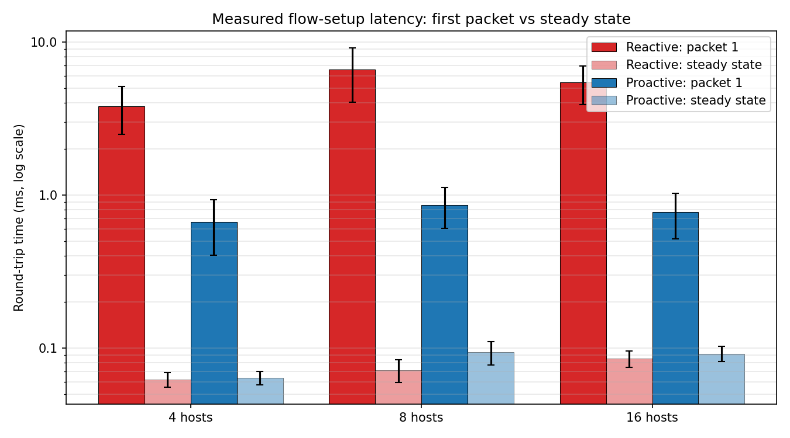
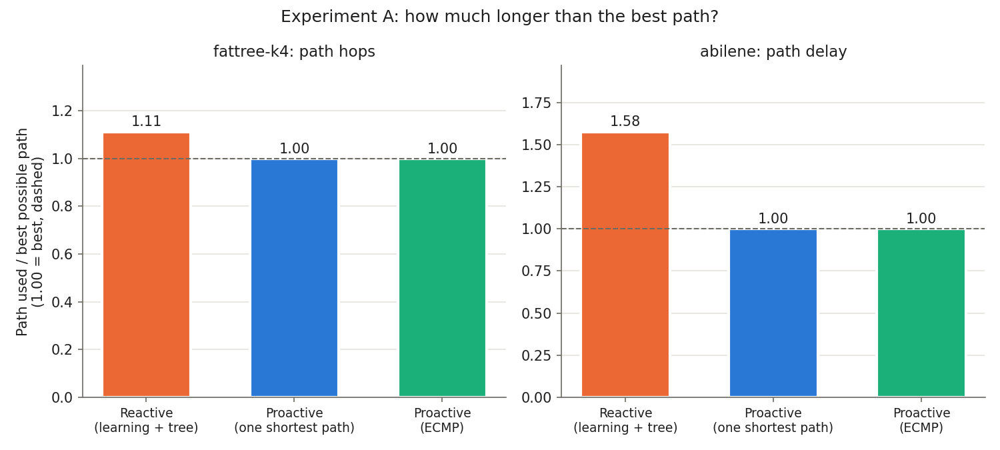
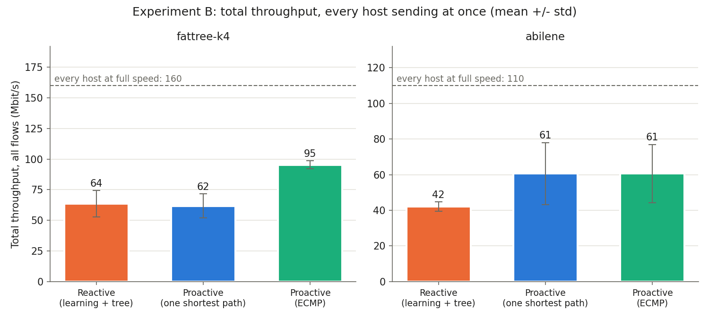
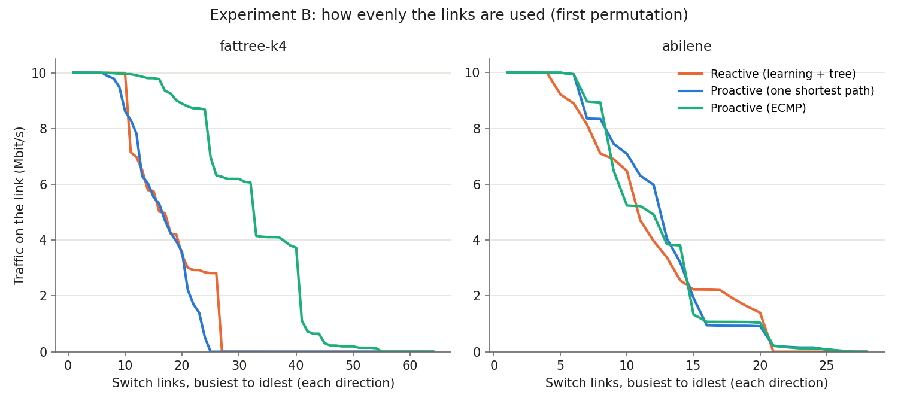
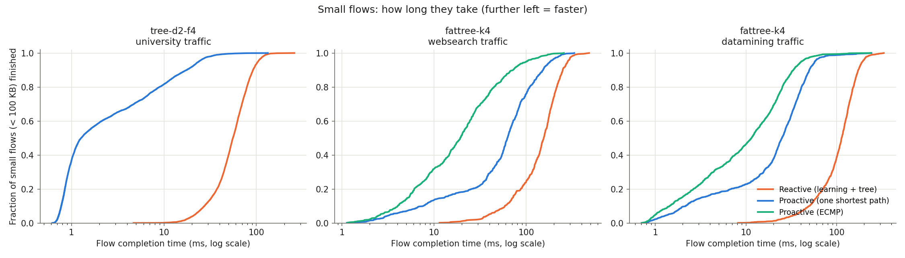
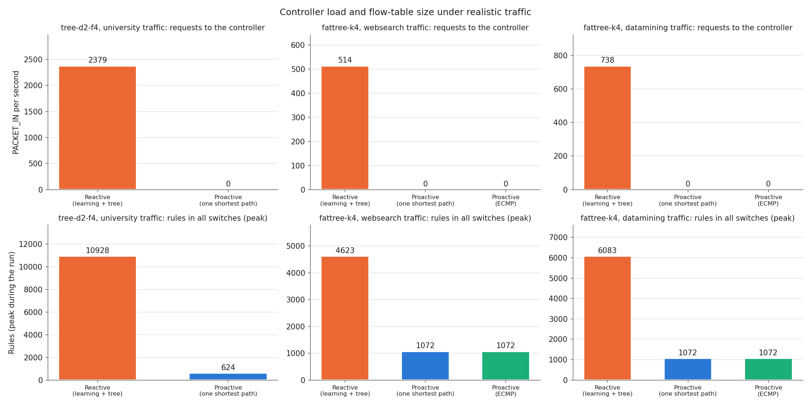
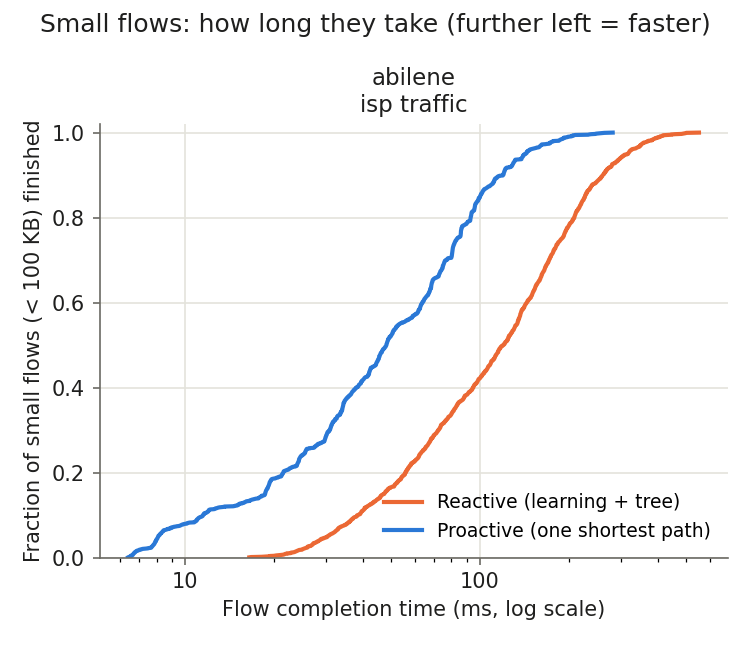

# CS G525 Research Project SA7: Progress Review II

**Project:** Empirical Evaluation of Reactive vs. Proactive Flow Installation in OpenFlow SDN
**Group:** 2
**Members:** N. NISARG VAGH, D. DHADUK MRUDUL HITESHBHAI, PRACHIT SURESH DESHINGE, Mukul Saini
**Review date:** 30 October 2026 (Progress Review II: working implementation, full experiments, preliminary analysis)
**Code and raw data:** <https://github.com/PrachitDeshinge-324/Openflow_SDN>
**Version:** 15 October 2026, with the Step 4 results (budgeted hybrid, long timeouts, oracle)

---

## 0. At a glance

**The question.** In OpenFlow SDN, a switch needs a rule before it can forward a packet. There are two ways to get one:
- **reactive:** ask the controller when the first packet of a flow arrives;
- **proactive:** install every rule in advance.

Which is better, by how much, and when?

**Everything below is measured** on Mininet 2.3.0 + Open vSwitch 3.7.1 (kernel datapath) + POX 0.7.0. It ran on our laptops (Windows 11, WSL2) with our own instrumented controllers.

| Since Review I we added | Headline result (reactive vs proactive) |
| --- | --- |
| Networks with many paths: a data-centre **fat-tree** and the real **Abilene** ISP backbone | Reactive's paths are up to **4.5× longer in delay**. Real pings are **51% slower** (40.5 vs 26.9 ms). Proactive always uses a best path. |
| **Load balancing** (ECMP) as a third controller | In the fat-tree, ECMP carries **50% more traffic** than reactive (95 vs 64 Mbit/s) and leaves only 16% of links idle (reactive leaves 59%). |
| **University traffic** (Benson et al., IMC 2010) | Small flows: **median 55.7 ms reactive vs 1.3 ms proactive (44×)**. The controller ran at **86% CPU** with 2,379 requests/s. |
| **Data-centre traffic** (DCTCP web search, VL2 data mining) | Small flows are **8–10× faster with proactive ECMP**, and large flows **3–3.6× faster**. |
| **Real ISP traffic** (Abilene traffic matrices, 2004) | Small flows: **median 120 vs 48 ms (2.5×)**. Measured split (Section 6, 5 runs): **about 41 ms from the spanning tree's detours, 10 ms from asking the controller**. |
| **Budgeted hybrid** (new controller): a weighted counter keeps the busiest host pairs pre-installed, within a rule budget | With 25% of pairs pre-installed: **54–66% of new connections skip the controller**, 2.3–2.7× fewer controller requests and 2.0–2.4× fewer rules than reactive. The simple counter reaches **0.88–0.93 of an oracle** that knows the future traffic (25–50% budgets). |
| **Long timeouts** (60 s / 300 s; the SmartTime idea in its simplest form) | **No gain in 4 of 4 scenarios** (slightly worse in one), and 2.2–3.0× more rules. |
| Review I **reproduced on a second laptop** | Same patterns, identical rule counts. |

**Every flow finished in every run (0 failures)**, and every controller got exactly the same traffic. Step 4 numbers are the mean of 5 runs with 95% confidence intervals; Sections 4 and 5 are single runs.

---

## 1. Response to the Review I feedback

Review I score: 7.5 / 10. The feedback, and what we did:

| Feedback | What we did | Where |
| --- | --- | --- |
| "Previous eval done and improvements done" | This report: Review I recap (Section 2), all new work (Sections 4–7), reproduced on a second laptop | Sections 2, 4–7 |
| "Increase the traffic like uni traffic, data centre, ISP" | Four realistic workloads, each from a published measurement: university, data-centre web search, data-centre data mining, and real Abilene ISP traffic matrices | Section 5 |
| "Parameters for evaluation: optimal path vs haphazard path" | New networks with many paths. We measured path stretch, delay, throughput and link balance for reactive (haphazard), proactive (optimal) and proactive ECMP | Section 4 |
| "Cmp with previous works / papers which already has predictor, traffic gen, emulator, etc." | Literature review of 14 papers (11 checked in full text), plus a survey of 28 prediction/ML rule papers and what they compare against. Our numbers are set next to theirs, and every network and traffic choice is traced to a paper. **Two published ideas now run as baselines on our testbed**: long timeouts (SmartTime / AH-IHTA) and a budgeted cache of popular rules (CacheFlow / PARD), plus an **oracle** that bounds what any predictor, ML included, could gain. | Sections 6, 7, `docs/literature/`, `docs/Evaluation_Plan.md` |
| "Run on multiple comps using distributed switches in lab" | **Tool ready, run pending.** POX can now run on a second PC (`controller_agent.py` + `--controller-host`), with the WSL2 networking steps documented. It is tested end to end on one machine; the two-PC run needs a second laptop. | Section 9, `docs/Controller_On_Second_PC.md` |

---

## 2. Recap: Review I results, now reproduced

**Setup.** Tree networks with 4, 8 and 16 computers. Two instrumented POX controllers:
- `reactive_eval`: the same logic as POX's `l2_learning`, with exact-match rules (idle 10 s, hard 30 s);
- `proactive_eval`: one rule per host pair on its shortest path, installed when the switch connects.

| Measurement (laptop 1, 27 Sep) | 4 computers | 8 computers | 16 computers |
| --- | --- | --- | --- |
| First packet, reactive (ms) | 3.81 | 6.60 | 5.44 |
| First packet, proactive (ms) | 0.67 | 0.86 | 0.77 |
| Later packets, both (ms) | 0.06–0.09 | 0.07–0.09 | 0.09 |
| Rules, proactive / reactive with all pairs active | 28 / 28 | 216 / 216 | 624 / 624 |
| Rules after 5 s of 200 new flows/s: reactive vs proactive | 2,321 vs 28 | 3,857 vs 216 | 2,631 vs 624 |
| Controller at 200 new flows/s, reactive: PACKET_IN/s, CPU | 465, 20.8% | 786, 36.4% | 544, 31.6% |

**Reproduced on laptop 2 (9 Oct).** Same software, a different machine:
- First packet, reactive: 7.2 / 11.4 / 8.7 ms; proactive: 1.0 / 1.5 / 1.0 ms.
- Rule counts were **identical**.
- At 200 new flows/s: 477 / 782 / 535 PACKET_IN/s.
- The 8-computer tree was again the slowest. It has the longest paths (4 switches), and reactive sets rules up switch by switch.



**Review I findings in short.**
1. Reactive's first packet is 5–8× slower, and the cost grows with the number of switches on the path.
2. Later packets are equal.
3. When every pair talks, proactive uses no more rules than reactive. Under churn, reactive's exact-match rules pile up to 4–83× more.

---

## 3. Testbed and method (common to all experiments)

| Item | Value |
| --- | --- |
| Emulator / switch / controller | Mininet 2.3.0, Open vSwitch 3.7.1 (kernel datapath), POX 0.7.0 (`gar`), OpenFlow 1.0 |
| Machine | Laptops with Windows 11 + WSL2 (Ubuntu, kernel 6.18), Python 3.14 |
| Controllers | **Reactive:** learning switch, exact-match rules, idle 10 s / hard 30 s. In networks with loops it runs over POX `openflow.discovery` + `openflow.spanning_tree`. **Proactive:** one rule per host pair on the lowest-cost path, plus a table-miss drop rule. **Proactive ECMP:** host pairs hashed (CRC32 of the MACs) across equal-cost paths. **Budgeted hybrid** (Section 6): reactive on shortest paths, plus pre-installed rules for the busiest host pairs within a budget. |
| Same conditions | Static ARP, IPv6 off, fixed random seed. **Every controller gets exactly the same pairs, traffic permutations and flow schedules.** |
| Measured, not modelled | Paths are read from the switches' flow tables (`ovs-ofctl dump-flows`); latency with ping / TCP flow completion times; controller load from counters inside our controllers; link loads from interface byte counters |
| Realism | Every network, traffic pattern and parameter is traced to a paper in `docs/Realism_Sources.md` (18 references) |

---

## 4. Experiment A: optimal path vs haphazard path

**Why.** A tree has one path between two hosts, so all controllers used the same path in Review I. Real networks have many paths.

**Networks.**
- **fat-tree, k = 4** (data centre; Al-Fares, SIGCOMM 2008): 20 switches, 16 hosts, up to 4 equal paths between pods.
- **Abilene** (real US research backbone; Internet Topology Zoo): 11 cities, 14 links. Each link delay is the city distance ÷ 200 km/ms (light in fibre), emulated with netem.
- **Link speed:** 10 Mbit/s on every link, so only the path choice matters.

**Controllers.**
- Reactive = learning switch over a spanning tree. Floods follow the tree, so paths are whatever the tree gives: **haphazard**.
- Proactive = lowest-delay path: **optimal**.
- Proactive ECMP = optimal paths, spread over the equal-cost ones.

**Traffic.**
- **A (paths):** 40 host pairs, 6 pings each. The real path is traced switch by switch.
- **B (throughput):** every host sends one TCP flow to another at the same time (permutation traffic, as in Al-Fares 2008 / Hedera 2010), 3 permutations × 10 s.

### Results (laptop, 15 Oct; `results/measured/paths-20261015-094800/`)

| Network | Controller | Hop stretch mean / max | Delay stretch mean / max | Pairs on a longer path | Ping RTT (ms) |
| --- | --- | --- | --- | --- | --- |
| fat-tree | Reactive | **1.11 / 1.50** | - | **22%** | 0.14 |
| fat-tree | Proactive | 1.00 / 1.00 | - | 0% | 0.13 |
| fat-tree | Proactive ECMP | 1.00 / 1.00 | - | 0% | 0.13 |
| Abilene | Reactive | **1.40 / 3.00** | **1.58 / 4.47** | **70%** | **40.51** |
| Abilene | Proactive | 1.02 / 1.33 | 1.00 / 1.00 | 0% | 26.90 |
| Abilene | Proactive ECMP | 1.02 / 1.33 | 1.00 / 1.00 | 0% | 26.24 |

| Network | Controller | Total throughput, Mbit/s (ideal) | Jain index over links | Links unused |
| --- | --- | --- | --- | --- |
| fat-tree | Reactive | 63.6 ± 10.7 (160) | 0.36 | 59% |
| fat-tree | Proactive | 61.7 ± 9.8 (160) | 0.33 | 63% |
| fat-tree | Proactive ECMP | **95.3 ± 3.3** (160) | **0.58** | **16%** |
| Abilene | Reactive | 42.1 ± 2.6 (110) | 0.56 | 29% |
| Abilene | Proactive | **60.7 ± 17.4** (110) | 0.52 | 20% |
| Abilene | Proactive ECMP | **60.6 ± 16.3** (110) | 0.52 | 20% |

The busiest link was at 100% in every run, so the links (not the laptop) were the bottleneck. 0 packets were lost.





### Findings

1. **ISP: reactive takes slow paths.**
   - 70% of pairs are on a slower path than necessary: +58% delay on average, up to 4.5× in the worst case.
   - Real pings are **40.5 ms against 26.9 ms**, and they match the map's prediction (39.3 vs 25.7 ms), which confirms the path tracing.
   - The cause is the spanning tree, which switches off 4 of Abilene's 14 links. Example: Atlanta → Washington has a direct 4.4 ms link, but reactive goes through Houston, Kansas City, Indianapolis, Chicago and New York (~23 ms).
2. **Data centre: one shortest path is not enough.**
   - One fixed shortest path gives no more throughput than reactive (62 vs 64 Mbit/s): both push traffic through the same core switch and leave ~60% of links idle.
   - **ECMP spreads the load: +50% throughput (95 Mbit/s), only 16% of links idle**, and the steadiest results.
3. **Nobody reaches the ideal.** ECMP on host pairs sometimes hashes two flows onto one link: the known ECMP collision problem (Al-Fares 2008, Hedera 2010).
4. **Reproducible.** A separate cloud-VM run produced exactly the same paths.

---

## 5. Experiment B: realistic traffic (university, data centre, ISP)

**Why.** Real traffic is mostly tiny flows, plus a few huge ones, arriving all the time. With reactive, every new flow costs a trip to the controller.

**Scenarios.** Each network carries the traffic measured in that kind of network:

| Scenario | Network | Flow sizes | Flow arrivals | Source |
| --- | --- | --- | --- | --- |
| University | campus tree, 16 hosts | 87% < 10 KB, largest 10% carry 96% of bytes | Weibull gaps, 80% between 4 and 40 ms per edge switch (~200 flows/s) | Benson et al., IMC 2010 (Fig. 4a, Sec. 5, Table 4) |
| Data centre, web search | fat-tree k = 4 | published table, mean 1.67 MB | Poisson, 30% load (~39 flows/s) | DCTCP (SIGCOMM 2010), as pFabric / PIAS `CDF_dctcp.tcl` |
| Data centre, data mining | fat-tree k = 4 | published table: 80% < 10 KB, but 95% of bytes in flows > 35 MB | Poisson, 30% load (~57 flows/s) | VL2 (SIGCOMM 2009), as pFabric / PIAS `CDF_vl2.tcl` |
| ISP | Abilene: real link speeds (Atlanta–Indianapolis at ¼), city delays (netem) | SURGE web sizes: median 12 KB, mean 65 KB | **Real Abilene traffic matrices** for Mon 1 Mar 2004, 24 hours replayed in 30 s, scaled so each link is as busy as in 2004 (~57 flows/s) | Zhang et al., IMC 2005; SURGE (Barford & Crovella 1998) |

**Measurement setup.**
- **What a flow is:** a TCP connection that sends N bytes and waits for a 1-byte reply. Flow completion time (FCT) runs from connect to reply.
- **Links:** 100 Mbit/s. Flows over 20 MB are capped to 20 MB, which affects 0–4% of flows.
- **Same flows for everyone:** the flow schedule is computed in advance, so every controller gets exactly the same flows.

### Results (laptop, 15 Oct; `results/measured/traffic-20261015-113417/` and `traffic-20261015-122618/`)

| Scenario | Controller | Small flows < 100 KB, FCT median / p99 (ms) | Large flows > 10 MB, mean FCT (s) | PACKET_IN/s | Controller CPU | Peak rules: all switches / one switch |
| --- | --- | --- | --- | --- | --- | --- |
| University | Reactive | **55.7** / 126.0 | - | **2,379** | **86.4%** | **10,928 / 3,377** |
| University | Proactive | **1.3** / 37.9 | - | 0 | 0.1% | 624 / 192 |
| DC web search | Reactive | 155.3 / 343.5 | 12.2 | 514 | 44.3% | 4,623 / 779 |
| DC web search | Proactive | 62.6 / 242.0 | 12.8 | 0 | 0.3% | 1,072 / 192 |
| DC web search | Proactive ECMP | **19.2** / 170.8 | **3.5** | 0 | 0.3% | 1,072 / **58** |
| DC data mining | Reactive | 113.0 / 244.2 | 10.9 | 738 | 56.3% | 6,083 / 1,003 |
| DC data mining | Proactive | 24.9 / 111.0 | 10.7 | 0 | 0.3% | 1,072 / 192 |
| DC data mining | Proactive ECMP | **11.5** / 67.7 | **3.6** | 0 | 0.3% | 1,072 / **58** |
| ISP (Abilene) | Reactive | **120.0** / 405.7 | - | 624 | 44.0% | 7,176 / 1,051 |
| ISP (Abilene) | Proactive | **48.1** / 198.4 | - | 0 | 0.2% | 386 / 62 |

Flows completed: 6,102 university, 1,159 web search, 1,707 data mining and 1,761 ISP, for every controller, with **0 failures**.





### Findings

1. **University traffic: small flows are 44× slower with reactive** (median 55.7 vs 1.3 ms). The network is only 6% loaded, so this is purely the cost of asking the controller about every new flow.
2. **The controller nears saturation, and a busy controller causes even more work.**
   - **Load:** 203 new flows/s caused 2,379 PACKET_INs/s at 86% CPU (POX is single-threaded).
   - **More requests than needed:** each flow caused ~12 PACKET_INs, although it needs at most ~6. While the controller is slow, more packets of the same flow reach the switch before its rule does, and each one asks again.
   - **Lighter load, fewer requests:** a 10-s run at a similar rate had a less-loaded controller (54% CPU) and only 7.4 requests per flow. Requests per flow grow with controller load: a feedback loop towards overload.
3. **Reactive fills the switches:** 17× more rules on the campus tree (10,928 vs 624), and up to 3,377 in one switch. For scale, the HP 5406zl hardware switch studied in DevoFlow holds 16K exact-match rules, and our network has only 16 hosts.
4. **Data centre: the path matters as much as the controller.**
   - Small flows are **8–10× faster with proactive ECMP than with reactive** (web search 19 vs 155 ms; data mining 11.5 vs 113 ms).
   - Large flows depend on load balance, not on the controller: ~11–13 s with reactive or one shortest path, **3.5 s with ECMP**.
5. **ISP: reactive pays twice.**
   - Small flows are 2.5× slower (120 vs 48 ms).
   - Both reactive's longer paths and waiting for the controller add time. Our first estimate from the ping round trips of Experiment A was ~27 ms for the paths and ~40 ms for the controller.
   - **Section 6 measures the split directly** by running reactive on shortest paths: **about 41 ms from the paths and 10 ms from the controller** (5 runs, faster power mode; a first single run gave 44 / 26 ms). The estimate had the two the wrong way round, so we use the measured split from now on.

---

## 6. Experiment C: how much does a rule budget buy? (Step 4)

**Why.** Sections 4 and 5 compare the two extremes: no rules in advance (reactive) and every rule in advance (proactive). Published work proposes things in between:
- keeping rules longer (SmartTime, AH-IHTA);
- caching only the popular rules (CacheFlow);
- hybrids that pre-install some flows (PARD);
- predictors that guess which flows will come (Batista 2024, mostly on IoT traffic).

We ran the simplest version of each idea on our testbed, with the same traffic as Section 5. All details are in `docs/Budgeted_Hybrid_Experiment.md`.

**Controllers added.**

| Mode | What it does | What it tests |
| --- | --- | --- |
| Reactive, long timeouts | Reactive, idle 60 s / hard 300 s instead of 10 s / 30 s | "Keep rules longer" (SmartTime, AH-IHTA) |
| Reactive on shortest paths | Our new `hybrid_eval` with budget 0: reactive, but it knows the map, so it uses shortest paths instead of the spanning tree | Separates the **setup cost** from the **path cost** |
| Hybrid, counter, 10 / 25 / 50% | Reactive on shortest paths, **plus** pair rules (source MAC + destination MAC) for the busiest host pairs, at most 10 / 25 / 50% of all pairs | A budget of popular rules (CacheFlow, PARD) |
| Oracle, 10 / 25 / 50% | Pre-installs the pairs that **really** carry the most flows in the run (read from the flow schedule), before the first flow | The best that **any** predictor (counter, ML, anything) can do with that budget |

**The counter.** Every second, for each host pair: `score = 0.97 × score + (1 if the pair was used this second, else 0)`.
- **How "used" is seen:** pre-installed pairs no longer reach the controller, so their use is read from the switch's packet counters.
- **What is kept:** the top-K scores keep pair rules.
- **Hysteresis:** a newcomer must score 1.5× the weakest kept pair to replace it, so pairs near the cut-off do not swap every second.

**Hit rate** = the share of new TCP connections whose first packet found a rule (no trip to the controller).

**Traffic.** Each scenario uses Section 5's traffic:
- **university, fat-tree:** host pairs get Zipf popularity (exponent 1), as CacheFlow assumes ("traffic tends to follow a Zipf distribution");
- **Abilene:** the real traffic matrices give the popularity;
- **a control run** uses uniform pairs.

### Results (laptop, night of 15–16 Oct; every value = mean of 5 runs ± 95% confidence interval; `results/measured/traffic-20261015-225412/`, `-233914/`, `traffic-20261016-004215/`, `-012626/`)

Every controller ran 5 times with seeds 7–11, so each run gets a new flow schedule from the same workload. "Median" is each run's small-flow median, averaged over the 5 runs.


| Scenario | Controller | Hit rate % | Small flows: median FCT (ms) | PACKET_IN/s | Controller CPU % | Peak rules |
| --- | --- | --- | --- | --- | --- | --- |
| University tree | Reactive | - | 27.9 ± 2.4 | 2,553 ± 114 | 67.2 ± 1.9 | 10,965 ± 637 |
| | Reactive, long timeouts | - | 29.6 ± 4.1 | 2,454 ± 106 | 64.8 ± 2.6 | **32,363 ± 2,018** |
| | Reactive, shortest paths | 0 | 27.3 ± 3.9 | 2,549 ± 130 | 68.1 ± 3.1 | 10,983 ± 663 |
| | Hybrid counter, 25% | 60.7 ± 5.5 | 8.4 ± 1.4 | 936 ± 209 | 35.4 ± 5.8 | 5,278 ± 1,205 |
| | Hybrid counter, 50% | 78.9 ± 1.8 | 2.8 ± 1.0 | 448 ± 66 | 18.7 ± 2.4 | 2,938 ± 347 |
| | Oracle, 25% / 50% | 68.2 / 84.7 | 5.0 / 1.7 | 658 / 324 | 25.6 / 12.9 | 3,586 / 2,012 |
| | Proactive | 100 | 0.96 ± 0.21 | 0 | 0.1 | 624 |
| Fat-tree, web search | Reactive | - | 110.8 ± 38.0 | 455 ± 42 | 25.6 ± 2.0 | 4,406 ± 569 |
| | Reactive, long timeouts | - | 111.7 ± 36.1 | 450 ± 35 | 25.8 ± 1.0 | **10,643 ± 969** |
| | Reactive, shortest paths | 0 | 59.3 ± 6.6 | 492 ± 55 | 25.8 ± 2.3 | 3,752 ± 428 |
| | Hybrid counter, 25% | 65.8 ± 1.4 | 38.2 ± 5.1 | 180 ± 14 | 10.1 ± 0.5 | 1,569 ± 89 |
| | Hybrid counter, 50% | 77.4 ± 1.8 | 35.0 ± 5.1 | 123 ± 15 | 7.4 ± 0.6 | 1,517 ± 84 |
| | Oracle, 25% / 50% | 73.7 / 88.3 | 34.0 / 31.6 | 139 / 63 | 7.1 / 3.3 | 1,221 / 984 |
| | Proactive ECMP | 100 | 28.6 ± 5.2 | 0 | 0.2 | 1,072 |
| Abilene ISP | Reactive | - | 96.8 ± 6.8 | 604 ± 22 | 27.1 ± 0.7 | 7,339 ± 148 |
| | Reactive, long timeouts | - | 97.3 ± 6.2 | 604 ± 16 | 27.3 ± 0.6 | **16,332 ± 427** |
| | Reactive, shortest paths | 0 | 55.6 ± 2.0 | 447 ± 17 | 20.8 ± 0.8 | 5,321 ± 111 |
| | Hybrid counter, 25% | 53.8 ± 2.3 | 50.0 ± 2.5 | 198 ± 19 | 10.7 ± 1.0 | 2,615 ± 245 |
| | Hybrid counter, 50% | 77.2 ± 1.8 | 47.4 ± 1.9 | 92 ± 11 | 5.5 ± 0.5 | 1,328 ± 143 |
| | Oracle, 25% / 50% | 59.2 / 83.0 | 49.4 / 47.2 | 169 / 67 | 9.0 / 3.8 | 2,418 / 1,141 |
| | Proactive | 100 | 46.0 ± 1.5 | 0 | 0.1 | 386 |

Flows per run: 6,073 ± 41 (university), 1,121 ± 27 (web search) and 1,749 ± 43 (ISP). **0 failures**, except that reactive and reactive with long timeouts lost flows in one fat-tree seed (5 ± 15 per run on average). The 10% budgets and the oracle's intervals are in the figure and in `docs/Budgeted_Hybrid_Experiment.md`, Section 4.0.


**Extra runs.**
- **Control, uniform pairs** (university, 5 runs): the counter's hit rate is 9.6 ± 0.2 / 24.5 ± 1.2 / 48.4 ± 0.2% at 10 / 25 / 50%, about the budget share itself. With no popular pairs there is nothing to learn.
- **Warm-up, 120 s instead of 30 s** (university, 10%, one run): the counter's hit rate rose from 24.5% to 38.1%; the oracle stayed at 51.5%. Part of the counter's gap at 10% is learning time.
- **Shorter memory, decay 0.9** (one run): 36.7% at 10%. That is inside the spread of the 0.97 repeats (30.8 ± 10.2%), so it is not evidence either way.

**Power mode.** These repeats ran with Windows "Best performance"; the first single runs (in `docs/Budgeted_Hybrid_Experiment.md`) ran in "Balanced". All absolute times are lower here; every ranking holds.

### Findings

1. **Long timeouts never help, and once they hurt.**
   - In all 4 scenarios: the same or a worse delay, the same controller load, and 2.2–3.0× the rules.
   - With uniform pairs the median is significantly slower: 25.7 ± 0.8 vs 23.6 ± 0.7 ms.
   - Why: reactive rules are exact matches, and every new TCP connection has a new source port, so a rule kept longer is never matched again. "Keep rules longer" does not help short-flow traffic unless the rules are coarser.
2. **Part of reactive's cost is the spanning tree, not the controller.** Running reactive on shortest paths separates the two (figure above):
   - **University tree:** essentially all of the gap (26 ms) is setup. A tree has one path, so the spanning tree costs nothing.
   - **Fat-tree:** about 52 ms is the spanning tree's path, 31 ms is setup plus ECMP's better load balance. Reactive's own median varies a lot (110.8 ± 38.0 ms).
   - **Abilene:** **41 ms is path, only 10 ms is setup.** 81% of reactive's extra delay on the ISP map comes from the detours.
   - **A faster CPU shrinks only the setup part.** In the earlier Balanced-mode runs the setup parts were 52 / 78 / 26 ms; the path parts were about the same as now. A faster controller can hide setup cost, never path cost.
3. **A small budget removes most of the setup cost when traffic is skewed.** With 25% of pairs pre-installed, compared with reactive on shortest paths:
   - 54–66% of new connections skip the controller;
   - 2.3–2.7× fewer PACKET_INs;
   - 2.0–2.4× **fewer** rules, because one pair rule replaces the many per-connection rules.

   The small-flow median drops 3.3× on the university tree (27.3 → 8.4 ms) and 1.6× on the fat-tree. On Abilene it drops only 1.1×, because there the setup part is small.
4. **The value of the budget comes from skew.**
   - **Uniform pairs:** a budget of B% buys about B% hit rate, the same as picking pairs at random.
   - **Zipf pairs, or real Abilene traffic:** 25% of pairs buys 54–66%.
   - **Real ISP traffic is skewed on its own:** the busiest 10% of city pairs carry a third of the flows. That is measured, not assumed.
5. **The simple counter is close to a perfect predictor.**
   - At 25–50% budgets it reaches **0.88–0.93 of the oracle's hit rate** in every skewed scenario. So ML could add at most 5–11 points of hit rate there.
   - **Weak spot:** a small budget (10%) on university traffic: 0.62 of the oracle, and the noisiest result (30.8 ± 10.2%).
   - **The cause is our design:** the counter scores a pair 0 or 1 per second, so pairs with 1.4 and 0.8 flows/s look alike. Counting flows instead is the obvious fix.
6. **On our small networks, proactive is still the best choice.** It is the fastest, has no controller load, and uses the fewest rules on the tree and on Abilene. A rule budget only matters when all pairs do not fit in the switches, which happens in large networks, not in 11–16-host ones. **We do not claim the hybrid beats proactive here.**

---

## 7. Comparison with previous work

### 7.1 Our measurements next to published numbers

| What | Published | Ours |
| --- | --- | --- |
| Reactive first-packet delay | 10 ms (NOX, in DIFANE); < 1.5 ms worst case (Ethane) | 3.8–6.6 ms (laptop 1), 7.2–11.4 ms (laptop 2) |
| Proactive / data-plane first packet | 0.4 ms (DIFANE) | 0.67–1.5 ms (includes Open vSwitch's cache fill) |
| Controller capacity | NOX ≈ 30k flows/s, NOX-MT 1.6M/s (Tootoonchian 2012) | POX: 2,379 PACKET_IN/s at 86% CPU, near its limit |
| Flow sizes in campus / enterprise data centres | 80% of flows < 10 KB (Benson 2010) | Our generator: 87% < 10 KB (uses Benson's curve) |
| ECMP leaves throughput on the table | Hash collisions limit ECMP (Al-Fares 2008, Hedera 2010) | ECMP reached 95 of 160 Mbit/s (60%), with the busiest links at 100% |
| Small rule budget serves most traffic | 90% hits with < 5% of rules (CacheFlow 2016) | Same direction, smaller effect: 54–66% hits with 25% of host pairs, 27–51% with 10% (Section 6). Our networks have only 110–240 pairs, and our hit rate counts connections, not packets |
| Timeouts cut controller load | −58% cost (SmartTime 2014); −28% setups (AH-IHTA 2020) | **Not for short-flow traffic with exact-match rules:** 60 s / 300 s timeouts gave no fewer controller requests and 2.2–3.0× more rules (Section 6) |
| ML predictors beat reactive | LSTM pre-install: −51% response time vs reactive (Batista 2024, IoT) | Beating reactive is easy: a plain counter cut controller requests 2.3–2.7×. The useful bound is the oracle: at 25–50% budgets the counter reaches 0.88–0.93 of it, so ML could add at most 5–11 points of hit rate |

Numbers from different papers are not directly comparable (different hardware, controllers and years). **The ranges and trends agree.**

### 7.2 Realism: the paper behind every choice

`docs/Realism_Sources.md` lists the source of every network, traffic pattern and parameter: 18 references, each marked "checked in PDF", "checked online", "data file" or "to check".
- **Networks:** Al-Fares 2008 (fat-tree); Topology Zoo and the Abilene dataset's own topology file (Abilene).
- **Traffic:** Benson 2010 (university); DCTCP / VL2 through the exact pFabric/PIAS tables (data centre); the real Abilene traffic matrices of Zhang et al. 2005 (ISP).

### 7.3 Previous methods run on our testbed

| Published idea | Our version | Status |
| --- | --- | --- |
| Longer timeouts (SmartTime, AH-IHTA) | Reactive with idle 60 s / hard 300 s | **Done** (Section 6). Adaptive timeouts are not implemented; fixed long ones already show the limit. |
| Cache of popular rules within a budget (CacheFlow); hybrid installation (PARD) | Budgeted hybrid with a weighted counter, 10 / 25 / 50% of pairs | **Done** (Section 6) |
| A predictor that knows which flows will come (Batista's LSTM, any ML) | The **oracle**: the best possible choice for a budget, used as the upper bound | **Done** (Section 6). A real ML model is optional (Section 9): the oracle already shows how little it could add at 25–50% budgets. |

The full list of comparisons, each next to the closest paper and what that paper does not measure, is in `docs/Evaluation_Plan.md`.

---

## 8. What we learned so far

| Situation | What decides performance | Winner |
| --- | --- | --- |
| Many small flows, light load (university) | The cost of setting up each new flow | **Proactive**: 44× faster small flows; the controller idles |
| Heavy load (data centre) | Path choice and load balance | **Proactive ECMP**: 8–10× faster small flows, 3× faster large flows |
| Wide-area network (ISP) | Both: longer paths **and** controller set-up | **Proactive**: 2.5× faster small flows |
| Every pair active, no churn (Review I) | Nothing: same number of rules | Tie |
| Skewed traffic, limited rule space (Section 6) | Which pairs get the scarce rules | **Budgeted hybrid**: 25% of pairs removes 54–66% of controller trips with fewer rules than reactive; a simple counter is close to the best possible choice |
| Uniform traffic (Section 6, control) | Nothing to learn | A budget buys only its own share |

**Reactive loses on both counts.** It pays a set-up cost for every new flow, and on networks with loops its paths are chosen by flooding, not by quality. Section 6 shows how much of each: on the ISP map the path costs more than the setup. Proactive's weak point is that it installs a rule for **every** pair, whether used or not; on larger networks this grows as N².

**What changed in our plan since Review I.** At Review I we planned an "idle-time hybrid": pre-install popular pairs only while the controller is quiet. Reading the literature (`docs/literature/`) showed that each in-between idea has been tested only on its own traffic and setup, and never side by side. So our contribution is the **measured comparison** (`docs/Evaluation_Plan.md`), not a new algorithm:
- **Built:** the budgeted hybrid, which is the popularity part of the plan.
- **Not built:** the idle-time scheduling. The counter's work (one statistics request per pre-installed pair per second) is small next to the PACKET_INs it saves.

**What we do not claim.** The budgeted hybrid is close to CacheFlow and PARD, and it does not beat proactive on our small networks.

---

## 9. Plan to the final submission (20 Nov)

| When | Work |
| --- | --- |
| Done (16 Oct) | **Repeats:** every Step 4 scenario 5× with different seeds, reported as mean ± 95% confidence interval (Section 6) |
| By 2 Nov | **Same rigour for Step 2:** re-run the realistic-traffic scenarios with `--repeats 5` in the same power mode, so all realistic-traffic numbers come from one setup |
| By 5 Nov | **Two PCs (feedback point "multiple computers"):** POX on one laptop, Mininet on another; same runs, to measure real control-channel delay and a controller with its own CPU (tool ready: `docs/Controller_On_Second_PC.md`) |
| 5–12 Nov | **The counter's weak spot:** a counter that counts flows instead of busy seconds, and a shorter memory (decay 0.9), at the 10% budget. **Optional:** an ML predictor (e.g. logistic regression) against the counter and the oracle at the same budget |
| 5–12 Nov | **A larger network** (fat-tree k = 6: 54 hosts, 2,862 pairs, if the laptop can run it), where proactive's N² rules start to matter |
| 12–20 Nov | Read the remaining full texts (PARD, the ML papers), check SURGE's parameters; final runs, final report and demo |

**Risks.**
- **POX near saturation:** POX is single-threaded and was at 86% CPU under university traffic, which also tells us where reactive breaks.
- **WSL2 timing and power mode:** the Windows power mode changed absolute times by up to 2× (Section 6), so every batch now runs in "Best performance" and results are compared only within a batch. The counter at a 10% budget is the noisiest result (30.8 ± 10.2% hit rate).
- **Small networks:** with 11–16 hosts proactive's rules always fit, so the rule budget is never forced. A larger network is planned; it may not fit on a laptop.
- **One unverified parameter:** SURGE's numbers (ISP flow sizes) are still to be checked against the paper. The ISP traffic *volumes* are real data.
- **Second PC:** depends on borrowing a laptop and on WSL2 mirrored networking (Windows 11).

---

## 10. How to reproduce

```bash
git clone https://github.com/PrachitDeshinge-324/Openflow_SDN.git && cd Openflow_SDN
bash setup.sh                                                  # first time only (see INSTALL.md)
sudo python3 experiments/run_experiments.py                    # Review I: latency, rules, churn (~15 min)
sudo python3 experiments/run_path_experiments.py               # Section 4: path quality (~15 min)
sudo python3 experiments/run_traffic_experiments.py            # Section 5: realistic traffic, 4 scenarios (~12 min)
sudo python3 experiments/run_traffic_experiments.py --scenarios tree-d2-f4:university --budget-sweep --pair-zipf 1   # Section 6 (~15 min)
sudo python3 experiments/run_traffic_experiments.py --scenarios fattree-k4:websearch --budget-sweep --pair-zipf 1
sudo python3 experiments/run_traffic_experiments.py --scenarios abilene:isp --budget-sweep
python3 docs/figures/make_step4_figures.py                     # Section 6 summary figures
sudo python3 demo/run_demo.py                                  # live demo (reactive vs proactive)
```

**Detailed documents:**
- `docs/Path_Quality_Experiment.md`
- `docs/Realistic_Traffic_Experiment.md`
- `docs/Budgeted_Hybrid_Experiment.md` (Step 4)
- `docs/Controller_On_Second_PC.md`
- `docs/Evaluation_Plan.md`: every comparison next to the closest paper
- `docs/Realism_Sources.md`
- `docs/literature/Literature_Review_IdleHybrid.md` and `docs/literature/ML_Rule_Prediction_Survey.md`
- `docs/Progress_Review_1.md`

**Raw data:** every run's raw data (each flow, each path, POX logs) is in `results/measured/`.
