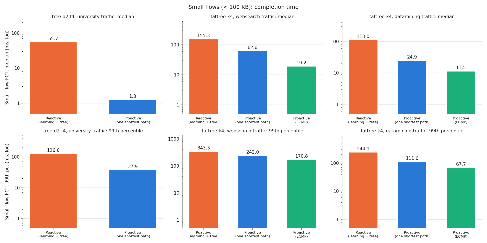

# Realistic Traffic: Reactive vs Proactive Under Published Workloads

CS G525 Advanced Computer Networks, Project SA7, Group 2. This is Step 2 after Progress Review I, in answer to the feedback "Increase the traffic like uni traffic, data centre, ISP". The paper behind every choice is tracked in [Realism_Sources.md](Realism_Sources.md).

## 1. Why a new experiment

Until now the traffic was simple:
- **Review I:** pings, plus single UDP packets at fixed rates.
- **Step 1:** one long TCP flow per host.

Real networks look different. **Most flows are tiny, a few are huge, and new flows arrive all the time.** That matters a lot for our question:
- **Reactive:** every new flow is a trip to the controller.
- **Proactive:** rules are already in place, so a new flow costs nothing.

## 2. Scenarios: each network with the traffic measured in that kind of network

| Scenario | Network | Traffic | Paper behind the traffic |
| --- | --- | --- | --- |
| University | `tree-d2-f4`: campus/enterprise tree, 5 switches, 16 hosts (as in Review I) | `university` | Benson et al., IMC 2010: measured 3 university data centres |
| Data centre, web search | `fattree-k4`: 20 switches, 16 hosts (as in Step 1) | `websearch` | DCTCP (SIGCOMM 2010) production search cluster, as the "web search" workload of pFabric (SIGCOMM 2013) |
| Data centre, data mining | `fattree-k4` | `datamining` | VL2 (SIGCOMM 2009) data-mining cluster, as the "data mining" workload of pFabric |

| ISP backbone | `abilene`: the US Internet2 backbone, 11 cities, 14 links (as in Step 1), with the real link speeds and city-to-city delays | `isp` | The **real Abilene traffic matrices** (Zhang et al., IMC 2005), flow sizes from SURGE (Barford & Crovella, 1998) |

The ISP scenario was added after the first laptop run below; its results are in Section 8.

## 3. How the traffic is made

Each workload is a **flow-size distribution** plus a **flow-arrival process**, both taken from the papers:

| | Flow sizes | When new flows start |
| --- | --- | --- |
| **University** | Read off Benson Fig. 4(a), university curves: **87% of flows < 10 KB**, the largest 10% of flows carry 96% of the bytes, and the largest is about 10 MB | At each edge switch, the gap between new flows follows a Weibull distribution (as in Benson Table 4) with **80% of gaps between 4 and 40 ms** (Benson Sec. 5). That is about 50 new flows/s per edge switch, **about 200 flows/s in total**. |
| **Web search** | The exact published table `CDF_dctcp.tcl` (the PIAS simulator, NSDI 2015): 16% of flows < 10 KB, but more than 95% of the bytes in flows > 1 MB. Mean 1.67 MB. | Poisson arrivals, random source and destination (as in pFabric). The rate is set so that the offered load is **30%** of host capacity, about 39 flows/s. |
| **Data mining** | The exact published table `CDF_vl2.tcl`: **80% of flows < 10 KB**, but 95% of the bytes in the 3.6% of flows > 35 MB. Mean 7.47 MB. | Poisson, 30% load, about 57 flows/s |

**Settings:**
- **Links:** every link is 100 Mbit/s. At that speed the university traffic loads the host links by only about 5%, matching Benson's finding that utilisation is low.
- **Cap on flow size:** flows larger than 20 MB are cut to 20 MB, so one run takes minutes. That affects 0% of university flows, about 1% of web search flows and about 4% of data mining flows. All the small flows are untouched.
- **Fair comparison:** the schedule of flows (start time, source, destination, size) is computed in advance with a fixed seed. **Every controller gets exactly the same flows.**
- **What one flow is:** the sender opens a TCP connection, sends N bytes and waits for the receiver's 1-byte reply. **Flow completion time (FCT)** is the time from the connect to that reply. Each host runs one server and one client, which are small Python scripts built into the experiment script.
- **Traffic window:** 30 s of flow arrivals; then the script waits for the last flows to finish. A flow counts as failed after 30 s without a reply.

## 4. Controllers

These are the same as in Step 1:
- **Reactive:** learning switch + POX spanning tree, exact-match rules, idle 10 s / hard 30 s.
- **Proactive:** one shortest path, with rules pre-installed per host pair.
- **Proactive ECMP:** host pairs spread over the equal paths. Fat-tree only, because in the tree there is only one path.

## 5. What is measured

| Metric | Meaning |
| --- | --- |
| **FCT of small flows** (< 100 KB): median and 99th percentile | The main metric in data-centre papers. These are the flows a controller trip hurts most. |
| FCT of medium and large flows (> 10 MB) | Large flows should barely notice the controller |
| Flows failed | No connection or no reply within 30 s |
| PACKET_IN/s, FLOW_MOD/s, controller CPU % | How hard the controller works under this traffic |
| Peak rules (all switches, one switch) | Flow-table size during the run; table-miss and discovery rules are not counted |

## 6. How to run

```bash
cd ~/Openflow_SDN
sudo python3 experiments/run_traffic_experiments.py --quick   # university only, 10 s, about 2 minutes
sudo python3 experiments/run_traffic_experiments.py           # all 4 scenarios, about 12 minutes
```

- **Output:** results go to `results/measured/traffic-<timestamp>/`: `traffic.md` (tables), `traffic.json` (every flow), `traffic_fct_cdf.png`, `traffic_small_fct.png`, `traffic_control.png`, and the POX logs.
- **Check the proactive runs first.** They should have **0 failed flows**. If the script prints "WARNING: ... this machine cannot keep up", the laptop (not the controller) is the bottleneck. Rerun with lower link speeds, e.g. `--bw 50` or `--bw 20`, and say which speed you used.
- **Other combinations:** `--scenarios fattree-k4:university tree-d2-f4:websearch` runs any network with any workload.

## 7. Results

**Report run:** laptop, Windows 11 + WSL2 (kernel 6.18.33.2), Open vSwitch 3.7.1 kernel datapath, POX 0.7.0, Python 3.14.4. Every link 100 Mbit/s, 30 s of flow arrivals, 30% target load for the data-centre workloads, flows capped at 20 MB. Run 15 Oct 2026; files are in [`results/measured/traffic-20261015-113417/`](../results/measured/traffic-20261015-113417/).

**Every flow finished in every run (0 failed)**, so the laptop kept up and the differences below come from the controllers.

### Traffic generated (identical for every controller)

| Scenario | Flows | New flows/s | Offered load | Flows capped at 20 MB | Flows leaving their edge switch |
| --- | --- | --- | --- | --- | --- |
| University on the campus tree | 6,102 | 203 | 93 Mbit/s (6%) | 0 | 81% |
| Web search on the fat-tree | 1,159 | 39 | 498 Mbit/s (31%) | 19 | 94% |
| Data mining on the fat-tree | 1,707 | 57 | 496 Mbit/s (31%) | 77 | 93% |

### Flow completion time (ms)

| Scenario | Controller | Small < 100 KB: mean / median / p99 | Medium: mean | Large > 10 MB: mean |
| --- | --- | --- | --- | --- |
| University | Reactive | **58.8 / 55.7 / 126.0** | 221.6 | - |
| University | Proactive | **5.6 / 1.3 / 37.9** | 163.1 | - |
| Web search | Reactive | 156.1 / **155.3** / 343.5 | 2,985.7 | 12,160.8 |
| Web search | Proactive (one shortest path) | 72.9 / 62.6 / 242.0 | 2,663.8 | 12,808.1 |
| Web search | Proactive ECMP | 30.3 / **19.2** / 170.8 | **669.9** | **3,547.9** |
| Data mining | Reactive | 113.6 / **113.0** / 244.2 | 712.9 | 10,882.5 |
| Data mining | Proactive (one shortest path) | 27.3 / 24.9 / 111.0 | 640.8 | 10,719.9 |
| Data mining | Proactive ECMP | 15.5 / **11.5** / 67.7 | **314.3** | **3,593.8** |

### Controller load and rules

| Scenario | Controller | PACKET_IN/s | PACKET_IN per new flow | Controller CPU | Peak rules (all switches) | Peak rules (one switch) |
| --- | --- | --- | --- | --- | --- | --- |
| University | Reactive | **2,379** | 11.7 | **86.4%** | **10,928** | **3,377** |
| University | Proactive | 0 | 0 | 0.1% | 624 | 192 |
| Web search | Reactive | 514 | 13.3 | 44.3% | 4,623 | 779 |
| Web search | Proactive (one shortest path) | 0 | 0 | 0.3% | 1,072 | 192 |
| Web search | Proactive ECMP | 0 | 0 | 0.3% | 1,072 | **58** |
| Data mining | Reactive | 738 | 13.0 | 56.3% | 6,083 | 1,003 |
| Data mining | Proactive (one shortest path) | 0 | 0 | 0.3% | 1,072 | 192 |
| Data mining | Proactive ECMP | 0 | 0 | 0.3% | 1,072 | **58** |





### What this shows

1. **University traffic: reactive makes small flows about 44 times slower.**
   - The typical (median) small flow takes **55.7 ms with reactive against 1.3 ms with proactive**. Even the mean is 10 times higher.
   - The network is almost idle (6% load), so this is purely the cost of asking the controller about every new flow.
2. **The controller is close to its limit.**
   - 203 new flows per second cause **2,379 PACKET_INs per second**, and POX (single-threaded) runs at **86% CPU**.
   - Each new flow causes about 12 PACKET_INs, although a flow needs at most about 6: SYN and SYN-ACK at up to 3 switches. When the controller is slow, more packets of the same flow reach the switch before its rule does, and each one asks the controller again.
   - In the 10-second quick run, at a similar flow rate, it was 7.4 per flow at 54% CPU. So **the busier the controller, the more requests each flow causes**: a feedback loop towards overload.
3. **Reactive fills the switches.**
   - There are 10,928 rules in total against 624 for proactive (**17 times more**), and up to 3,377 in a single switch.
   - For scale: the HP 5406zl hardware switch studied in DevoFlow (in our literature review) holds 16,000 exact-match rules. **One of our switches already uses a fifth of that with only 16 hosts**, and the number grows with every extra new flow per second.
4. **Data centre: reactive's small flows are 8–10 times slower than ECMP.**
   - Web search median: 155 ms (reactive) against 63 ms (one shortest path) against **19 ms (ECMP)**.
   - Data mining median: 113 ms against 25 ms against **11.5 ms**.
   - On the fat-tree a new flow needs rules at up to 5 switches in a row, so it waits for the controller up to 5 times in each direction: about 13 PACKET_INs per flow.
5. **Data centre: large flows depend on the path, not the controller.**
   - Large flows take about 11–13 s with reactive or one shortest path, but **3.5–3.6 s with ECMP, 3 to 3.6 times faster**.
   - Reactive and one shortest path both squeeze traffic onto a few core links (as in Step 1). ECMP spreads it.
   - ECMP also needs the smallest tables: at most 58 rules in any switch, against 192 for one shortest path and up to 1,003 for reactive.
6. **Together with Step 1:**
   - With **many small flows**, the cost of setting up each flow decides, and proactive wins.
   - With **heavy traffic**, path choice and load balance decide, and proactive with ECMP wins.
   - Reactive loses on both. That is the case for our idle-time hybrid: pre-install rules for the popular pairs on balanced paths, without pre-installing everything.

**Reproducibility:** a validation run on a cloud VM (userspace datapath, slower) gave the same ranking. There, university small flows were about 12 times slower with reactive, and ECMP was the only controller with no failed data-centre flows. Its files are in [`results/validation_traffic_cloud_userspace/`](../results/validation_traffic_cloud_userspace/).

**Commit the laptop run:** add `results/measured/traffic-20261015-113417/` to the repo with this document; the charts above link to it.

## 8. ISP traffic: real Abilene traffic matrices

**Data:** the public Abilene traffic matrices from <https://www.cs.utexas.edu/~yzhang/research/AbileneTM/> (Zhang et al., IMC 2005). They come from real NetFlow measurements, sampled 1 in 100, and record how much traffic each Abilene router sent to every other router every 5 minutes, March–September 2004. Our copy of the readme and the topology file is in `data/abilene/`.

**How we turn it into traffic** (`experiments/abilene_tm.py`, then the `isp` workload):
1. We take week X01, day 1 (**Monday 1 March 2004**) and average each hour, giving 24 hourly matrices for 110 city pairs.
   - **Real values only:** the file also has 4 estimates per pair; we use the measured value.
   - **One Atlanta:** the dataset has two Atlanta routers. We merge them; the second one, ATLA-M5, carries under 1% of the traffic.
   - **Backbone traffic only:** traffic that enters and leaves at the same city is dropped, because it never crosses the backbone.
2. **That day's real traffic:** it ranged from **2.3 Gbit/s (night) to 4.3 Gbit/s (US afternoon)**. The biggest pairs were Washington DC → New York and Los Angeles → Chicago, each 5.5% of the traffic at the evening peak.
3. **The whole day is replayed in 30 s** (1.25 s per hour), so the run sees the real rise and fall during the day.
4. **Volumes are scaled to our network:** our 100 Mbit/s links stand for Abilene's 9.92 Gbit/s links, so traffic is scaled by the same factor. **Every link is then as busy, relative to its speed, as it was in 2004**: about 31 Mbit/s on average.
5. **Flows between city pairs** arrive at random (Poisson) at a rate proportional to the real volume of that pair in that hour. Flow sizes follow **SURGE** (lognormal body, Pareto tail): median 12 KB, mean 65 KB. This gives about **57 new flows/s**.
6. **The network is as real as we can make it:**
   - the 14 real links;
   - the real link speeds, so Atlanta–Indianapolis is a quarter of the others, as in 2003;
   - the city-to-city delays from Step 1, emulated with netem when the kernel has it.

**Run it alone:**
```bash
sudo python3 experiments/run_traffic_experiments.py --scenarios abilene:isp
python3 experiments/abilene_tm.py X02.gz --day 3      # another day; then --tm data/abilene/tm-<date>.json
```

**Report run:** laptop, WSL2, Open vSwitch kernel datapath, 100 Mbit/s links (Atlanta–Indianapolis 25 Mbit/s), **real city-to-city delays emulated with netem**. Run 15 Oct 2026; files are in [`results/measured/traffic-20261015-122618/`](../results/measured/traffic-20261015-122618/). 1,761 flows (59 new flows/s, 27.5 Mbit/s offered); **every flow finished with both controllers.**

| Controller | Small flows < 100 KB: mean / median / p99 (ms) | Medium: mean (ms) | PACKET_IN/s | Controller CPU | Peak rules (all switches / one switch) |
| --- | --- | --- | --- | --- | --- |
| Reactive | **136.8 / 120.0 / 405.7** | 292.5 | **624** | 44.0% | **7,176 / 1,051** |
| Proactive | **59.5 / 48.1 / 198.4** | 177.9 | 0 | 0.2% | 386 / 62 |


### What this shows

1. **With real ISP traffic, reactive makes small flows about 2.5 times slower.** The median is 120 ms against 48 ms, and the slowest 1% take 406 ms against 198 ms.
2. **Where the extra 72 ms goes.** This is a rough split, using the path delays measured in Step 1. A small flow needs about two round trips: the connection setup, then the data and the reply.
   - **Proactive's 48 ms** is about two round trips on the best paths: Step 1 measured a 25.7 ms round trip on average, and 2 × 25.7 ≈ 51 ms.
   - **Longer paths, about 27 ms:** reactive's spanning-tree paths have a 39.3 ms round trip (Step 1), so two round trips take about 79 ms, 27 ms more than proactive's best paths.
   - **Controller set-up, about 40 ms:** the rest comes from waiting for the controller at up to 5 switches in a row, in both directions.

   So **in an ISP, reactive costs twice**: once for the longer paths and once for the controller.

   **Correction (Step 4).** This split was an estimate. Step 4 measured it directly by running the same reactive logic on shortest paths, with the same traffic (`docs/Budgeted_Hybrid_Experiment.md`, Section 4.6):
   - small-flow median 117.5 ms with reactive;
   - 73.4 ms on shortest paths;
   - 47.8 ms with proactive.

   That is **about 44 ms from the paths and 26 ms from the controller**, so the estimate above had the two the wrong way round. The 5-run repeats (faster power mode) gave about 41 ms and 10 ms: the path part stayed, and the setup part shrank with the faster CPU.
3. **Controller load and flow tables grow the same way as in the data centre.**
   - **Requests:** 59 new flows/s cause 624 PACKET_INs/s, about 10.6 per flow, at 44% CPU.
   - **Rules:** 7,176 against proactive's 386, which is **19 times more**.

**Reproducibility:** a cloud-VM validation run, without netem, gave the same ranking. There, small flows averaged 203 ms with reactive against 18 ms with proactive. Its files are in [`results/validation_traffic_cloud_userspace/isp-100M-no-netem/`](../results/validation_traffic_cloud_userspace/isp-100M-no-netem/).

## 9. Notes and limits

- **The traffic is generated, not replayed.** It has the published statistics (sizes, arrival rates, burstiness through the arrival process), not real packets. This is the standard method in data-centre papers (pFabric, PIAS, and others).
- **ON/OFF behaviour.** Benson also describes ON/OFF bursts with lognormal OFF periods, but gives the parameters only as plots. We model burstiness through the measured arrival gaps only.
- **The university size curve was read by eye.** It comes from Benson's Fig. 4(a), which is a log-scale plot, so the points are approximate. They agree with the paper's text (80% of flows < 10 KB, most bytes in the largest 10%).
- **The ISP controller is local.** In a real ISP the controller sits in one city, so its messages to distant switches take tens of ms. Here it is on the same machine. Running the controller on a second PC (`docs/Controller_On_Second_PC.md`; tool ready, run pending) starts to add this.
- **SURGE comes from web traffic.** Its flow sizes come from web workloads of the late 1990s and are only a stand-in for 2004 backbone flows. The traffic *volumes* between cities are real.
- **Python adds overhead.** The traffic generator is Python, so very small FCTs include some scheduling delay. It is the same for every controller, so comparisons are fair.
